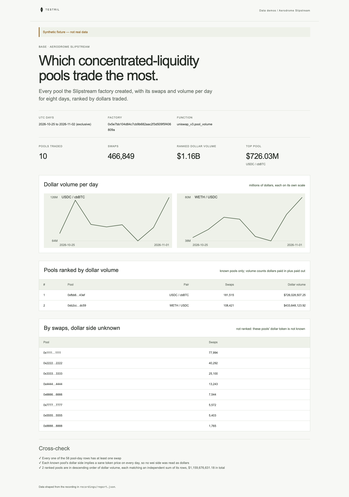

# Aerodrome Slipstream

Swaps and volume per pool per day for every pool created by the Aerodrome
Slipstream factory on Base, ranked by dollars traded. The page proves its
numbers: every pool-day row has at least one swap, each known pool's dollar side
implies a sane token price, and the ranking is in descending order of dollar
volume that matches an independent sum of each pool's rows.

**The shipped recording is synthetic.** `recordings/report.json` is generated
by `test/fixture.mjs` and the page says so in its banner. The eight pools
without a known dollar side use made-up addresses (`0x1111…`). Record real data
with `tools/prepare` (below).



## Prerequisites

- Node.js 22.13 or later

## Run

Working directory: `demos/aerodrome-slipstream`

```sh
npm ci
npm start
```

Open http://127.0.0.1:4180 (set `PORT` to change it). Expected result: the
synthetic banner, four headline numbers, a daily dollar-volume line for each
ranked pool, a table of ranked pools, a table of unranked pools, and three passed cross-checks.

## Test

```sh
npm test
npx playwright install chromium
npm run test:browser
npm run lint
npm run format:check
```

`npm test` checks the cross-check passes on the fixture and fails on a pool-day
with zero swaps, a duplicated pool-day, or a day outside the window, that the
dollar side of each pool (not the 18-decimal side) decides the ranking, and
that the server returns the shaped report. `npm run test:browser` writes
`docs/screenshot-desktop.png`. `npm run fixture` regenerates the synthetic
recording.

## Subjects and window

- Factory: Aerodrome Slipstream CL factory on Base,
  `0x5e7bb104d84c7cb9b682aac2f3d509f5f406809a` (verify before recording).
- Window: UTC days `[2026-10-25, 2026-11-02)`, eight days. `to_day` is
  exclusive.
- Volume is a pool's tokens paid in plus paid out, in raw units. Pools of
  different token pairs can only be compared in dollars, so the ranking uses
  the dollar side of the pools listed in `knownPools` in `src/report.mjs`. Any
  other pool is listed in a separate table by swaps, with no dollar volume.

| Pool         | Address                                      | Dollar side      | Note                    |
| ------------ | -------------------------------------------- | ---------------- | ----------------------- |
| WETH / USDC  | `0xb2cc224c1c9fee385f8ad6a55b4d94e92359dc59` | `volume1` (USDC) | verify before recording |
| USDC / cbBTC | `0xfbb6eed8e7aa03b138556eedaf5d271a5e1e43ef` | `volume0` (USDC) | verify before recording |

USDC on Base is `0x833589fcd6edb6e08f4c7c32d4f71b54bda02913` with 6 decimals.

## Binds (`testril.json`)

| Name          | Function                 | Chain | Params                         | Window                  |
| ------------- | ------------------------ | ----- | ------------------------------ | ----------------------- |
| `pool-volume` | `uniswap_v3.pool_volume` | 8453  | `swap.pool_list.factory`, `by` | 2026-10-25 → 2026-11-02 |

## Record real data

Needs a funded payment channel and an operator key in `tools/prepare/.env`; both
are absent after extraction from the repository. Verify the USDC / cbBTC pool is
from the Slipstream factory first. Run from `demos/aerodrome-slipstream`; it
writes `recordings/report.json` with source `"dev"`.

```sh
npm run record
```
