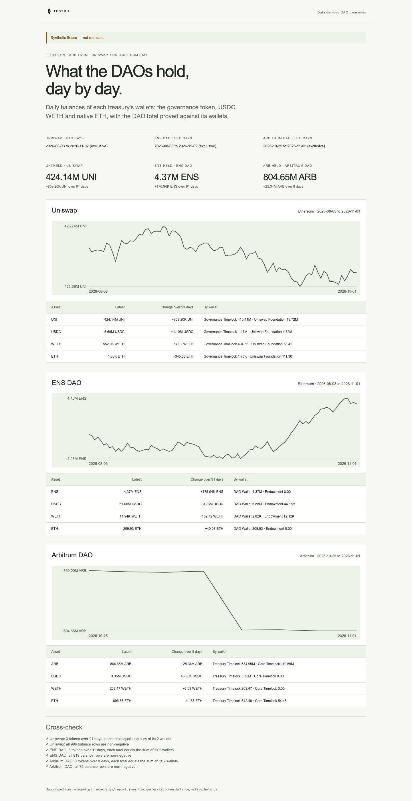

# DAO treasuries

What the Uniswap, ENS and Arbitrum DAO treasuries hold, per day: one card per
DAO with its holdings (governance token, USDC, WETH, native ETH, split by
wallet) and a line of the governance token over the window. The page proves its
numbers: for every token and day, the DAO total read over all its wallets must
equal the sum of the same token read one wallet at a time, and no balance may be
negative.

**The shipped recording is synthetic.** `recordings/report.json` is generated
by `test/fixture.mjs` and the page says so in its banner. Record real data with
`tools/prepare` (below).



## Prerequisites

- Node.js 22.13 or later

## Run

Working directory: `demos/dao-treasuries`

```sh
npm ci
npm start
```

Open http://127.0.0.1:4180 (set `PORT` to change it). Expected result: the
synthetic banner, three headline numbers, three DAO cards each with a line and
a holdings table, and six passed cross-checks.

## Test

```sh
npm test
npx playwright install chromium
npm run test:browser
npm run lint
npm run format:check
```

`npm test` checks the cross-check passes on the fixture and fails when one
wallet is one raw unit off on one day, when a wallet's day is missing, when a
native balance is negative, and when the governance token vanishes for a day,
and that the server returns the shaped report. `npm run test:browser` writes
`docs/screenshot-desktop.png`. `npm run fixture` regenerates the synthetic
recording.

## Subjects and window

- Ethereum (Uniswap, ENS DAO): UTC days `[2026-08-03, 2026-11-02)`, 91 days,
  each read at the day's last block.
- Arbitrum (Arbitrum DAO): UTC days `[2026-10-25, 2026-11-02)`, 8 days.
- Per DAO, `<dao>-tokens` reads the three tokens over both wallets,
  `<dao>-tokens-<wallet>` reads them one wallet at a time, and `<dao>-native`
  reads each wallet's native ETH. A token a wallet does not hold has no row.

| DAO          | Wallet              | Address                                      | Note                    |
| ------------ | ------------------- | -------------------------------------------- | ----------------------- |
| Uniswap      | Governance Timelock | `0x1a9c8182c09f50c8318d769245bea52c32be35bc` |                         |
| Uniswap      | Uniswap Foundation  | `0x3d30b1ab88d487b0f3061f40de76845bec3f1e94` | verify before recording |
| ENS DAO      | DAO Wallet          | `0xfe89cc7abb2c4183683ab71653c4cdc9b02d44b7` |                         |
| ENS DAO      | Endowment           | `0x4f2083f5fbede34c2714affb3105539775f7fe64` | verify before recording |
| Arbitrum DAO | Treasury Timelock   | `0xf3fc178157fb3c87548baa86f9d24ba38e649b58` | verify before recording |
| Arbitrum DAO | Core Timelock       | `0x34d45e99f7d8c45ed05b5ca72d54bbd1fb3f98f0` | verify before recording |

| Token | Chain    | Address                                      | Decimals |
| ----- | -------- | -------------------------------------------- | -------- |
| UNI   | Ethereum | `0x1f9840a85d5af5bf1d1762f925bdaddc4201f984` | 18       |
| ENS   | Ethereum | `0xc18360217d8f7ab5e7c516566761ea12ce7f9d72` | 18       |
| USDC  | Ethereum | `0xa0b86991c6218b36c1d19d4a2e9eb0ce3606eb48` | 6        |
| WETH  | Ethereum | `0xc02aaa39b223fe8d0a0e5c4f27ead9083c756cc2` | 18       |
| ARB   | Arbitrum | `0x912ce59144191c1204e64559fe8253a0e49e6548` | 18       |
| USDC  | Arbitrum | `0xaf88d065e77c8cc2239327c5edb3a432268e5831` | 6        |
| WETH  | Arbitrum | `0x82af49447d8a07e3bd95bd0d56f35241523fbab1` | 18       |

## Binds (`testril.json`)

Windows are half-open: the end is the first day not included.

| Name                                | Function              | Chain | Window                  |
| ----------------------------------- | --------------------- | ----- | ----------------------- |
| `uniswap-tokens`                    | `erc20.token_balance` | 1     | 2026-08-03 → 2026-11-02 |
| `uniswap-tokens-timelock`           | `erc20.token_balance` | 1     | 2026-08-03 → 2026-11-02 |
| `uniswap-tokens-foundation`         | `erc20.token_balance` | 1     | 2026-08-03 → 2026-11-02 |
| `uniswap-native`                    | `native.balance`      | 1     | 2026-08-03 → 2026-11-02 |
| `ens-tokens`                        | `erc20.token_balance` | 1     | 2026-08-03 → 2026-11-02 |
| `ens-tokens-dao-wallet`             | `erc20.token_balance` | 1     | 2026-08-03 → 2026-11-02 |
| `ens-tokens-endowment`              | `erc20.token_balance` | 1     | 2026-08-03 → 2026-11-02 |
| `ens-native`                        | `native.balance`      | 1     | 2026-08-03 → 2026-11-02 |
| `arbitrum-tokens`                   | `erc20.token_balance` | 42161 | 2026-10-25 → 2026-11-02 |
| `arbitrum-tokens-treasury-timelock` | `erc20.token_balance` | 42161 | 2026-10-25 → 2026-11-02 |
| `arbitrum-tokens-core-timelock`     | `erc20.token_balance` | 42161 | 2026-10-25 → 2026-11-02 |
| `arbitrum-native`                   | `native.balance`      | 42161 | 2026-10-25 → 2026-11-02 |

## Record real data

Recording needs `tools/prepare` from this repository and a Testril operator
key with an existing funded channel; it signs vouchers only and never deposits.
Neither is part of an extracted demo. From the repository root:

```sh
cd tools/prepare && npm ci && cp .env.example .env   # set TESTRIL_MCP_URL and TESTRIL_OPERATOR_KEY
node prepare.mjs --plan ../../demos/dao-treasuries   # free estimate
cd ../../demos/dao-treasuries && npm run record
```

`npm run record` replaces `recordings/report.json` with `source: "dev"`, the
bound function ids, job ids and timings. The page then shows "Recorded from
Testril on <date>".
