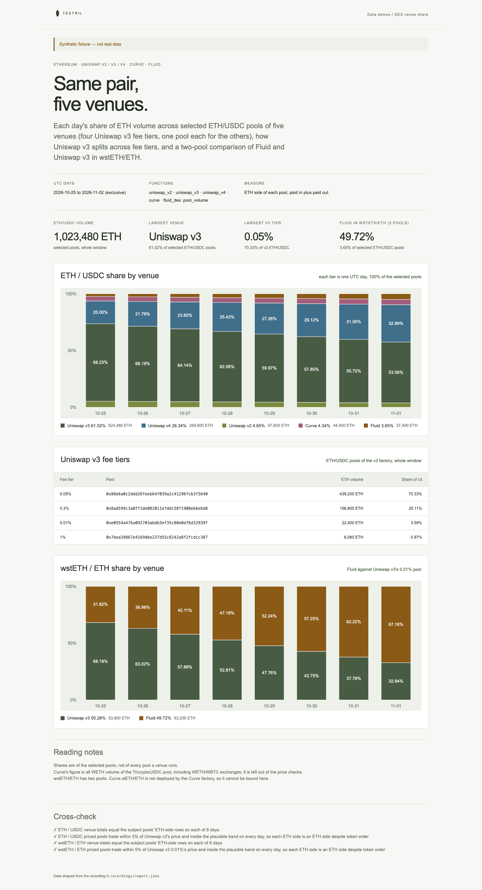

# DEX venue share

Daily share of ETH volume across selected ETH/USDC pools of Uniswap v2, v3,
v4, Curve and Fluid on Ethereum (four Uniswap v3 fee tiers, one pool each for
the others, so shares are of the selected pools, not of each venue), how
Uniswap v3 splits across its fee tiers, and a two-pool comparison of Fluid and
Uniswap v3 in wstETH/ETH. The page proves its numbers: each day's venue totals
must equal the subject pools' ETH-side rows, and every priced pool's USDC (or
wstETH) per ETH must sit within 5% of the first pool's price and inside a
broad band (500 to 20,000 USDC per ETH, below 1 wstETH per ETH), which fails
if a pool's ETH side is read from the wrong token column.

**The shipped recording is synthetic.** `recordings/report.json` is generated
by `test/fixture.mjs` and the page says so in its banner. Record real data with
`tools/prepare` (below).



## Prerequisites

- Node.js 22.13 or later

## Run

Working directory: `demos/dex-venue-share`

```sh
npm ci
npm start
```

Open http://127.0.0.1:4180 (set `PORT` to change it). Expected result: the
synthetic banner, four headline numbers, a stacked share chart per day for
ETH/USDC, the Uniswap v3 fee-tier table, a stacked share chart for
wstETH/ETH, and four passed cross-checks and the reading notes.

## Test

```sh
npm test
npx playwright install chromium
npm run test:browser
npm run lint
npm run format:check
```

`npm test` checks the cross-checks pass on the fixture and fail when v4's
USDC side is read as ETH, when a subject pool is counted twice, when both
wstETH pools have their sides swapped, or when a day has no volume, that leftover basis points go to the largest remainders, and
that the server returns the shaped report. `npm run test:browser` writes
`docs/screenshot-desktop.png`. `npm run fixture` regenerates the synthetic
recording.

## Subjects and window

- Window: UTC days `[2026-10-25, 2026-11-02)`, eight days. Each pool function
  is bound to its factory (or the v4 pool manager) and reads every pool; the
  report picks the subject pools below.
- Measure: the ETH side of each pool, paid in plus paid out, in raw 18-decimal
  units. Uniswap v2, v3 and Fluid sort tokens by address, so USDC and wstETH
  are token0 and WETH or the native-ETH sentinel (`0xEeee...`) is token1; v4
  sorts native ETH (address 0) first. These side claims are assumptions to
  check against `fluid_dex.pool_list` and the v4 pool key before recording.
  `src/report.mjs` records which field holds the ETH side of each pool.
- Curve rows are per coin index and cannot isolate a pair. The Curve figure is
  all WETH volume (coin 2) of the TricryptoUSDC pool, including WETH/WBTC
  exchanges, and Curve is left out of the price checks. Pair-level flow would
  need `curve.exchange`.
- Uniswap v4 and Fluid count native ETH, the others WETH; the demo treats both
  as ETH.
- Shares are of the selected pools: four Uniswap v3 fee tiers, one pool each
  for v2, v4, Curve and Fluid. Other v4 ETH/USDC pool ids are not included.
- wstETH/ETH is a two-pool comparison of Fluid and Uniswap v3's 0.01% pool.
  Curve stETH/ETH (`0xdc24316b9ae028f1497c275eb9192a3ea0f67022`) is not
  deployed by the Tricrypto-NG factory, so the Curve bind cannot reach it, and
  no Uniswap v4 wstETH/ETH pool is included.
- All addresses are lowercase.

| Subject                      | Address                                                              | Note                    |
| ---------------------------- | -------------------------------------------------------------------- | ----------------------- |
| Uniswap v2 factory           | `0x5c69bee701ef814a2b6a3edd4b1652cb9cc5aa6f`                         |                         |
| Uniswap v3 factory           | `0x1f98431c8ad98523631ae4a59f267346ea31f984`                         |                         |
| Uniswap v4 PoolManager       | `0x000000000004444c5dc75cb358380d2e3de08a90`                         |                         |
| Curve Tricrypto-NG factory   | `0x0c0e5f2ff0ff18a3be9b835635039256dc4b4963`                         | verify before recording |
| Fluid DEX factory            | `0x91716c4eda1fb55e84bf8b4c7085f84285c19085`                         | verify before recording |
| Uniswap v2 USDC/WETH pair    | `0xb4e16d0168e52d35cacd2c6185b44281ec28c9dc`                         |                         |
| Uniswap v3 USDC/WETH 0.05%   | `0x88e6a0c2ddd26feeb64f039a2c41296fcb3f5640`                         |                         |
| Uniswap v3 USDC/WETH 0.3%    | `0x8ad599c3a0ff1de082011efddc58f1908eb6e6d8`                         |                         |
| Uniswap v3 USDC/WETH 0.01%   | `0xe0554a476a092703abdb3ef35c80e0d76d32939f`                         | verify before recording |
| Uniswap v3 USDC/WETH 1%      | `0x7bea39867e4169dbe237d55c8242a8f2fcdcc387`                         | verify before recording |
| Uniswap v4 ETH/USDC pool id  | `0x21c67e77068de97969ba93d4aab21826d33ca12bb9f565d8496e8fda8a82ca27` | verify before recording |
| Curve TricryptoUSDC pool     | `0x7f86bf177dd4f3494b841a37e810a34dd56c829b`                         | verify before recording |
| Fluid ETH/USDC dex pool      | `0x2886a01a0645390872a9eb99dae1283664b0c524`                         | verify before recording |
| Uniswap v3 wstETH/WETH 0.01% | `0x109830a1aaad605bbf02a9dfa7b0b92ec2fb7daa`                         | verify before recording |
| Fluid wstETH/ETH dex pool    | `0x0b1a513ee24972daef112bc777a5610d4325c9e7`                         | verify before recording |

Also verify token0/token1 of both Fluid pools in `fluid_dex.pool_list` (the
ETH/USDC pool's address and order are the least certain), that ETH is the
token0 side of the v4 pool, and that Curve coin 2 is WETH. The price
cross-check fails on a wrong side.

## Binds (`testril.json`)

Windows are half-open: the end is the first day not included.

| Name         | Function                 | Chain | Params                         | Window                  |
| ------------ | ------------------------ | ----- | ------------------------------ | ----------------------- |
| `uniswap-v2` | `uniswap_v2.pool_volume` | 1     | `swap.pool_list.factory`, `by` | 2026-10-25 → 2026-11-02 |
| `uniswap-v3` | `uniswap_v3.pool_volume` | 1     | `swap.pool_list.factory`, `by` | 2026-10-25 → 2026-11-02 |
| `uniswap-v4` | `uniswap_v4.pool_volume` | 1     | `swap.manager`, `by`           | 2026-10-25 → 2026-11-02 |
| `curve`      | `curve.pool_volume`      | 1     | `swap.pool_list.factory`, `by` | 2026-10-25 → 2026-11-02 |
| `fluid-dex`  | `fluid_dex.pool_volume`  | 1     | `swap.pool_list.factory`, `by` | 2026-10-25 → 2026-11-02 |

Each read returns every pool of the factory for each day; the real recording
is much larger than the synthetic one.

## Record real data

Recording needs `tools/prepare` from this repository and a Testril operator
key with a funded channel; neither is part of an extracted demo. Recording
signs vouchers only and never deposits. From the repository root:

```sh
cd tools/prepare && npm ci && cp .env.example .env   # set TESTRIL_MCP_URL and TESTRIL_OPERATOR_KEY
node prepare.mjs --plan ../../demos/dex-venue-share   # free estimate
cd ../../demos/dex-venue-share && npm run record
```

`npm run record` replaces `recordings/report.json` with `source: "dev"`, the
bound function ids, job ids and timings. The page then shows "Recorded from
Testril on <date>".
