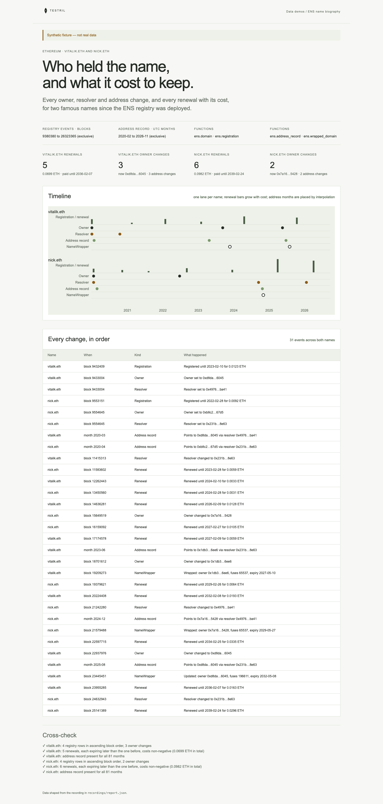

# ENS name biography

The life of two famous ENS names on Ethereum since the registry was deployed:
every owner, resolver and address change, and every registration and renewal
with its cost in ETH. The page proves its numbers: each renewal must expire
later than the one before, costs must be integer wei, a wrapped name's expiry
must equal the registrar expiry plus the 90-day grace period, registry rows
must be in block order, and the address record must cover every month.

**The shipped recording is synthetic.** `recordings/synthetic.json` is generated
by `test/fixture.mjs` and the page says so in its banner. Its owners,
resolver switches and timelines are invented; the owner addresses are
synthetic. Record real data with
`npm run record` (below).



## Prerequisites

- Node.js 22.13 or later

## Run

Working directory: `demos/ens-name-biography`

```sh
npm ci
npm start
```

Open http://127.0.0.1:4180 (set `PORT` to change it). Expected result: the
synthetic banner, four headline numbers (renewals and owner changes per name),
a timeline with one lane per name, a table of every change in order, and six
passed cross-checks.

## Test

```sh
npm test
npx playwright install chromium
npm run test:browser
npm run lint
npm run format:check
```

`npm test` checks the cross-check passes on the fixture and fails when renewals
expire out of order, when a cost is in ETH instead of wei, when a wrapped
expiry lacks the grace period or the registrar expiry is in milliseconds, when
registry rows are out of block order, or when a month is missing or duplicated, and that the
server returns the shaped report. `npm run test:browser` writes
`docs/screenshot-desktop.png`. `npm run fixture` regenerates the synthetic
recording.

## Subjects and window

Registry history starts at the registry deployment (block 9380380, early
2020); earlier history lives in the pre-2020 registry and is not covered.
Windows are half-open: the end is the first block or month not included.

| Subject                       | Address                                      | Note                    |
| ----------------------------- | -------------------------------------------- | ----------------------- |
| ENS registry                  | `0x00000000000c2e074ec69a0dfb2997ba6c7d2e1e` |                         |
| BaseRegistrar                 | `0x57f1887a8bf19b14fc0df6fd9b2acc9af147ea85` |                         |
| ETHRegistrarController (2020) | `0x283af0b28c62c092c9727f1ee09c02ca627eb7f5` | verify before recording |
| ETHRegistrarController (2023) | `0x253553366da8546fc250f225fe3d25d0c782303b` | verify before recording |
| ETHRegistrarController (2025) | `0x59e16fccd424cc24e280be16e11bcd56fb0ce547` | verify before recording |
| NameWrapper                   | `0xd4416b13d2b3a9abae7acd5d6c2bbdbe25686401` |                         |

Names: `vitalik.eth` and `nick.eth`. Registry and registrar start blocks
(9380380) and the NameWrapper start block (16925758, its creation block, so the
wrapped window means "since the wrapper existed") are also to verify before
recording. `cost` counts only the listed controllers.

Both names were registered before the window starts, and the registrar rows
carry no event kind. The first registrar row in the window is therefore labelled
"First in window" and is not counted as a renewal: with real data it is most
likely a renewal. Renewals, renewal cost and owner changes count only what
follows the first row.

## Binds (`testril.json`)

| Name                                        | Function             | Chain | Params                                   | Window              |
| ------------------------------------------- | -------------------- | ----- | ---------------------------------------- | ------------------- |
| `vitalik-domain`, `nick-domain`             | `ens.domain`         | 1     | `registry`, `name`                       | 9380380 → 26323365  |
| `vitalik-registration`, `nick-registration` | `ens.registration`   | 1     | `base_registrar`, `label`, `controllers` | 9380380 → 26323365  |
| `vitalik-address`, `nick-address`           | `ens.address_record` | 1     | `registry`, `name`, `by` (`month`)       | 2020-01 → 2026-11   |
| `vitalik-wrapped`, `nick-wrapped`           | `ens.wrapped_domain` | 1     | `name_wrapper`, `name`                   | 16925758 → 26323365 |

Address-record months have no block, so the timeline places them by linear
interpolation across the block window.

## Record real data

The demo records itself. It needs a private key whose address holds Testril
usage credits; it pays with vouchers against those credits, so the wallet
needs no USDC.

| Variable            | Purpose                                                    |
| ------------------- | ---------------------------------------------------------- |
| `TESTRIL_PAYER_KEY` | Hex private key that signs vouchers; required to record    |
| `TESTRIL_MCP_URL`   | Testril MCP endpoint; default `https://dev.testril.ai/mcp` |

Working directory: `demos/ens-name-biography`

```sh
export TESTRIL_PAYER_KEY=<hex private key>
npm run record
```

For each bind in `testril.json`, `npm run record` calls `bind`, asks
`materialize` for the whole window (Testril charges only for blocks not yet
indexed), waits for the job, then `read`s the window. It writes
`recordings/recorded.json` (git-ignored) with `source: "dev"`, the bound
function ids, job ids, timings and the usage credits spent. The page then
shows "Recorded from Testril on <date>". A failed run leaves the previous
recording in place.

`npm test` runs `npm run record` against a fake Testril: it pays with the
payer's vouchers, follows each `materialize` answer and keeps every row.
