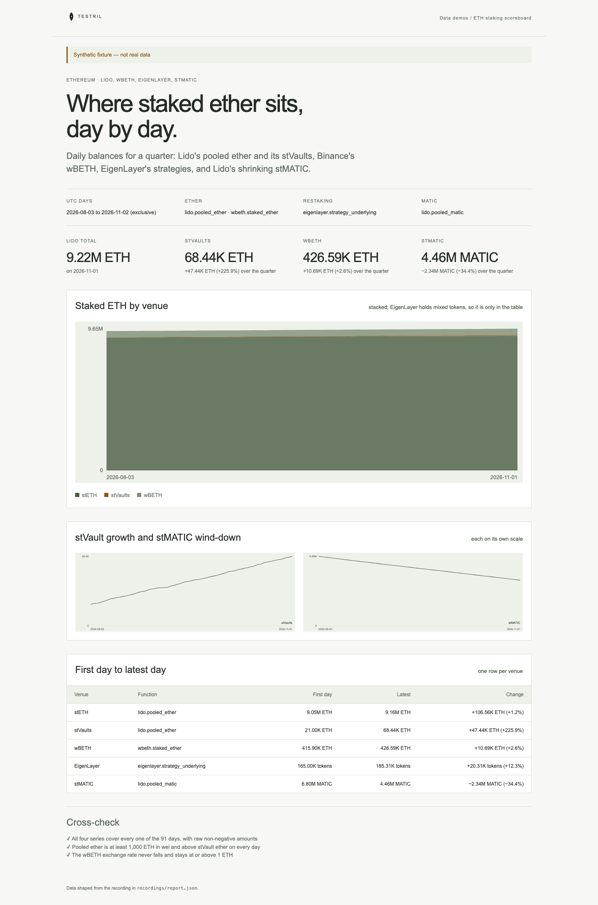

# ETH staking scoreboard

Daily staked ether on Ethereum for a quarter: Lido's pooled ether and its V3
stVaults, Binance's wBETH, EigenLayer's strategies, and Lido's stMATIC
shrinking. The page proves its inputs: every series covers every day with raw
integer amounts in wei, Lido's total equals pooled ether plus stVault ether, and
the wBETH exchange rate stays at or above 1 ETH. Two checks are heuristics, not
contract guarantees: stVault ether below pooled ether, and a wBETH rate that
never falls. A real slashing event would fail the page.

**The shipped recording is synthetic.** `recordings/synthetic.json` is generated
by `test/fixture.mjs` and the page says so in its banner. Record real data with
`npm run record` (below).



## Prerequisites

- Node.js 22.13 or later

## Run

Working directory: `demos/eth-staking-scoreboard`

```sh
npm ci
npm start
```

Open http://127.0.0.1:4180 (set `PORT` to change it). Expected result: the
synthetic banner, four headline numbers, four line charts (stETH, stVaults, wBETH, stMATIC), each on its own
scale, a table of five rows and four passed cross-checks.

## Test

```sh
npm test
npx playwright install chromium
npm run test:browser
npm run lint
npm run format:check
```

`npm test` checks the cross-check passes on the fixture and fails on a missing
day, an amount in whole units instead of wei (Lido, wBETH, stMATIC), stVault ether above pooled ether and a
falling wBETH rate, and that the server returns the shaped report.
`npm run test:browser` writes `docs/screenshot-desktop.png` (it needs port 4181
free). `npm run fixture` regenerates the synthetic recording.

## Subjects and window

Window: UTC days `[2026-08-03, 2026-11-02)`, each read at its last block, so the
last day is 2026-11-01. EigenLayer's `eigenlayer.strategy_underlying` is sparse:
a strategy has no row before it is whitelisted or while its shares are zero.
EigenLayer amounts are in each strategy's own token units and cannot be added,
so the page validates them and shows only the number of strategies in the
table.

| Subject                    | Address                                      | Note                    |
| -------------------------- | -------------------------------------------- | ----------------------- |
| Lido stETH                 | `0xae7ab96520de3a18e5e111b5eaab095312d7fe84` |                         |
| Binance wBETH              | `0xa2e3356610840701bdf5611a53974510ae27e2e1` |                         |
| Lido stMATIC               | `0x9ee91f9f426fa633d227f7a9b000e28b9dfd8599` |                         |
| EigenLayer StrategyManager | `0x858646372cc42e1a627fce94aa7a7033e7cf075a` |                         |
| Lido VaultHub              | `0x1d201be093d847f6446530efb0e8fb426d176709` | verify before recording |

`vault_hub_from_block` (24000000) is also a placeholder: verify before
recording. Below it `vault_ether` is 0. The fixture uses the real mainnet EigenLayer strategy
addresses for stETH (`0x93c4b944d05dfe6df7645a86cd2206016c51564d`), rETH
(`0x1bee69b7dfffa4e2d53c2a2df135c388ad25dcd2`) and cbETH
(`0x54945180db7943c0ed0fee7edab2bd24620256bc`) with synthetic amounts; a real
recording reads them from `eigenlayer.strategy_list`.

## Binds (`testril.json`)

Windows are half-open: the end day is not included.

| Name         | Function                         | Chain | Params                                             | Window                  |
| ------------ | -------------------------------- | ----- | -------------------------------------------------- | ----------------------- |
| `lido`       | `lido.pooled_ether`              | 1     | `steth`, `vault_hub`, `vault_hub_from_block`, `by` | 2026-08-03 → 2026-11-02 |
| `wbeth`      | `wbeth.staked_ether`             | 1     | `wbeth`, `by`                                      | 2026-08-03 → 2026-11-02 |
| `stmatic`    | `lido.pooled_matic`              | 1     | `st_matic`, `by`                                   | 2026-08-03 → 2026-11-02 |
| `eigenlayer` | `eigenlayer.strategy_underlying` | 1     | `strategy_list`, `by`                              | 2026-08-03 → 2026-11-02 |

## Record real data

The demo records itself. It needs a private key whose address holds Testril
usage credits; it pays with vouchers against those credits, so the wallet
needs no USDC.

| Variable            | Purpose                                                    |
| ------------------- | ---------------------------------------------------------- |
| `TESTRIL_PAYER_KEY` | Hex private key that signs vouchers; required to record    |
| `TESTRIL_MCP_URL`   | Testril MCP endpoint; default `https://dev.testril.ai/mcp` |

Working directory: `demos/eth-staking-scoreboard`

```sh
export TESTRIL_PAYER_KEY=<hex private key>
npm run record
```

For each bind in `testril.json`, `npm run record` calls `bind`, asks
`materialize` for the whole window (Testril charges only for blocks not yet
indexed), waits for the job, then `read`s the window. It writes
`recordings/recorded.json` (git-ignored) with `source: "dev"`, the bound
function ids, job ids, timings and the usage credits spent. The page then
shows "Recorded from Testril on <date>". A failed run leaves the previous
recording in place.

`npm test` runs `npm run record` against a fake Testril: it pays with the
payer's vouchers, follows each `materialize` answer and keeps every row.
