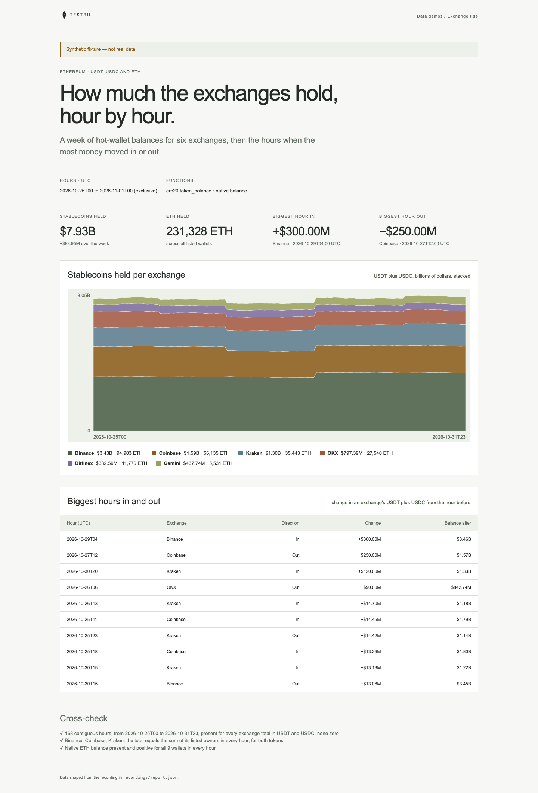

# Exchange tide

USDT, USDC and ETH held by the hot wallets of six exchanges on Ethereum, hour
by hour for a week: a stacked chart of stablecoins per exchange and a table of
the hours when the most money moved in or out. The page proves its numbers:
for every exchange with several wallets, the total Testril returns must equal
the sum of its wallets in every hour, with no missing, zero or out-of-window
hours.

**The shipped recording is synthetic.** `recordings/report.json` is generated
by `test/fixture.mjs` and the page says so in its banner. Record real data with
`tools/prepare` (below).



## Prerequisites

- Node.js 22.13 or later

## Run

Working directory: `demos/exchange-tide`

```sh
npm ci
npm start
```

Open http://127.0.0.1:4180 (set `PORT` to change it). Expected result: the
synthetic banner, four headline numbers, a stacked area of stablecoins per
exchange, a table of the ten biggest hours in or out, and three passed
cross-checks.

## Test

```sh
npm test
npx playwright install chromium
npm run test:browser
npm run lint
npm run format:check
```

`npm test` checks the cross-check passes on the fixture and fails when a total
is only its first wallet, when the two tokens are swapped, when an hour is
missing, when a gap is zero-filled and when an hour is outside the window, and
that the biggest hours are ranked by size and direction. `npm run test:browser`
writes `docs/screenshot-desktop.png`. `npm run fixture` regenerates the
synthetic recording.

## Subjects and window

- USDT `0xdac17f958d2ee523a2206206994597c13d831ec7` and USDC
  `0xa0b86991c6218b36c1d19d4a2e9eb0ce3606eb48`, both 6 decimals.
- Window: UTC hours `[2026-10-25T00, 2026-11-01T00)`, 168 hours, each read at
  the hour's last block. The end is exclusive.
- `erc20.token_balance` returns one total per token per hour for the owners
  named, so each wallet of a multi-wallet exchange also has its own bind to
  check the total against.

| Exchange | Wallet      | Address                                      | Note                    |
| -------- | ----------- | -------------------------------------------- | ----------------------- |
| Binance  | Binance 14  | `0x28c6c06298d514db089934071355e5743bf21d60` |                         |
| Binance  | Binance 8   | `0xf977814e90da44bfa03b6295a0616a897441acec` |                         |
| Coinbase | Coinbase 10 | `0xa9d1e08c7793af67e9d92fe308d5697fb81d3e43` |                         |
| Coinbase | Coinbase 6  | `0x3cd751e6b0078be393132286c442345e5dc49699` | verify before recording |
| Kraken   | Kraken 4    | `0x267be1c1d684f78cb4f6a176c4911b741e4ffdc0` | verify before recording |
| Kraken   | Kraken 1    | `0x2910543af39aba0cd09dbb2d50200b3e800a63d2` | verify before recording |
| OKX      | OKX 73      | `0x6cc5f688a315f3dc28a7781717a9a798a59fda7b` | verify before recording |
| Bitfinex | Bitfinex 2  | `0x77134cbc06cb00b66f4c7e623d5fdbf6777635ec` | verify before recording |
| Gemini   | Gemini 4    | `0xd24400ae8bfebb18ca49be86258a3c749cf46853` | verify before recording |

## Binds (`testril.json`)

Windows are half-open: the end is the first hour not included.

| Name               | Function              | Owners                  | Window                        |
| ------------------ | --------------------- | ----------------------- | ----------------------------- |
| `binance-total`    | `erc20.token_balance` | 2 owner(s), USDT + USDC | 2026-10-25T00 → 2026-11-01T00 |
| `binance-owner-1`  | `erc20.token_balance` | 1 owner(s), USDT + USDC | 2026-10-25T00 → 2026-11-01T00 |
| `binance-owner-2`  | `erc20.token_balance` | 1 owner(s), USDT + USDC | 2026-10-25T00 → 2026-11-01T00 |
| `binance-native`   | `native.balance`      | 2 owner(s)              | 2026-10-25T00 → 2026-11-01T00 |
| `coinbase-total`   | `erc20.token_balance` | 2 owner(s), USDT + USDC | 2026-10-25T00 → 2026-11-01T00 |
| `coinbase-owner-1` | `erc20.token_balance` | 1 owner(s), USDT + USDC | 2026-10-25T00 → 2026-11-01T00 |
| `coinbase-owner-2` | `erc20.token_balance` | 1 owner(s), USDT + USDC | 2026-10-25T00 → 2026-11-01T00 |
| `coinbase-native`  | `native.balance`      | 2 owner(s)              | 2026-10-25T00 → 2026-11-01T00 |
| `kraken-total`     | `erc20.token_balance` | 2 owner(s), USDT + USDC | 2026-10-25T00 → 2026-11-01T00 |
| `kraken-owner-1`   | `erc20.token_balance` | 1 owner(s), USDT + USDC | 2026-10-25T00 → 2026-11-01T00 |
| `kraken-owner-2`   | `erc20.token_balance` | 1 owner(s), USDT + USDC | 2026-10-25T00 → 2026-11-01T00 |
| `kraken-native`    | `native.balance`      | 2 owner(s)              | 2026-10-25T00 → 2026-11-01T00 |
| `okx-total`        | `erc20.token_balance` | 1 owner(s), USDT + USDC | 2026-10-25T00 → 2026-11-01T00 |
| `okx-native`       | `native.balance`      | 1 owner(s)              | 2026-10-25T00 → 2026-11-01T00 |
| `bitfinex-total`   | `erc20.token_balance` | 1 owner(s), USDT + USDC | 2026-10-25T00 → 2026-11-01T00 |
| `bitfinex-native`  | `native.balance`      | 1 owner(s)              | 2026-10-25T00 → 2026-11-01T00 |
| `gemini-total`     | `erc20.token_balance` | 1 owner(s), USDT + USDC | 2026-10-25T00 → 2026-11-01T00 |
| `gemini-native`    | `native.balance`      | 1 owner(s)              | 2026-10-25T00 → 2026-11-01T00 |

All binds are on chain 1 and read `by: "hour"`. `<exchange>-total` names every
wallet of the exchange; `<exchange>-owner-N` names one.

## Record real data

Recording needs `tools/prepare` from this repository and a Testril operator
key with a funded channel; neither is part of an extracted demo. From the
repository root:

```sh
cd tools/prepare && npm ci && cp .env.example .env   # set TESTRIL_MCP_URL and TESTRIL_OPERATOR_KEY
node prepare.mjs --plan ../../demos/exchange-tide   # free estimate
cd ../../demos/exchange-tide && npm run record
```

`npm run record` replaces `recordings/report.json` with `source: "dev"`, the
bound function ids, job ids and timings. The page then shows "Recorded from
Testril on <date>".
