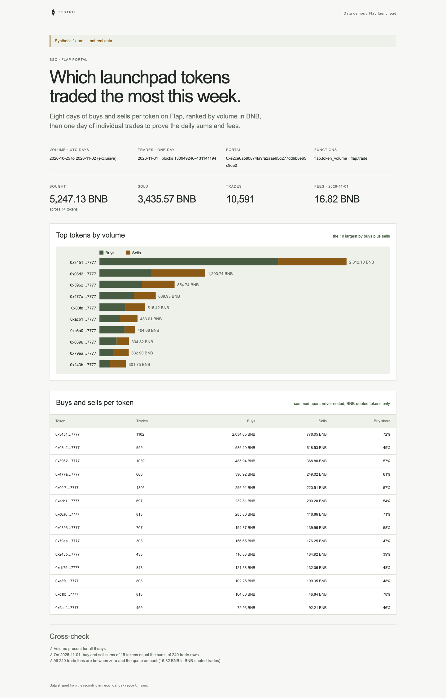

# Flap launchpad

Which launchpad tokens traded the most on Flap (BSC) over eight days: BNB
bought and sold per token, ranked by volume. The page proves its numbers: for
one day, each token's daily buy and sell sums must equal the sums of its
individual trade rows, and every trade fee must be non-negative.

**The shipped recording is synthetic.** `recordings/report.json` is generated
by `test/fixture.mjs` and the page says so in its banner. Record real data with
`tools/prepare` (below).



## Prerequisites

- Node.js 22.13 or later

## Run

Working directory: `demos/flap-launchpad`

```sh
npm ci
npm start
```

Open http://127.0.0.1:4180 (set `PORT` to change it). Expected result: the
synthetic banner, four headline numbers, a buys-vs-sells bar chart of the ten
largest tokens, a table of all ranked tokens, and three passed cross-checks.

## Test

```sh
npm test
npx playwright install chromium
npm run test:browser
npm run lint
npm run format:check
```

`npm test` checks the cross-check passes on the fixture and fails when a sell
is read as a buy, when volume is in BNB instead of raw wei, when a trade is
missing, when a fee is negative, or when a day is missing, and that the server
returns the shaped report. `npm run test:browser` writes
`docs/screenshot-desktop.png`. `npm run fixture` regenerates the synthetic
recording.

## Subjects and window

- Flap portal on BSC `0xe2ce6ab80874fa9fa2aae65d277dd6b8e65c9de0`
  (verify before recording).
- Volume: UTC days `[2026-10-25, 2026-11-02)`, per token and quote asset.
- Trades: 2026-11-01, blocks `[130949246, 131141195)`, found by binary search
  over the public BSC RPC. They match the volume rows for 2026-11-01.
  Verify before recording: block 130949246 must have timestamp
  2026-11-01 00:00:00 UTC or later with block 130949245 earlier, and block
  131141195 must be the first at or after 2026-11-02 00:00:00 UTC. The
  window covers 191,949 blocks against BSC's roughly 192,000 per day.
- Amounts are raw wei of the quote asset. The page ranks tokens quoted in BNB
  (the zero address) only.

## Binds (`testril.json`)

Windows are half-open: the end is the first block or day not included.

| Name     | Function            | Chain | Params       | Window                  |
| -------- | ------------------- | ----- | ------------ | ----------------------- |
| `volume` | `flap.token_volume` | 56    | `swap`, `by` | 2026-10-25 → 2026-11-02 |
| `trades` | `flap.trade`        | 56    | `portal`     | 130949246 → 131141195   |

`trades` is read in chunks of 20000 blocks.

## Record real data

Recording needs `tools/prepare` from this repository and a Testril operator
key with a funded channel; neither is part of an extracted demo. From the
repository root:

```sh
cd tools/prepare && npm ci && cp .env.example .env   # set TESTRIL_MCP_URL and TESTRIL_OPERATOR_KEY
node prepare.mjs --plan ../../demos/flap-launchpad   # free estimate
cd ../../demos/flap-launchpad && npm run record
```

`npm run record` replaces `recordings/report.json` with `source: "dev"`, the
bound function ids, job ids and timings. The page then shows "Recorded from
Testril on <date>".
