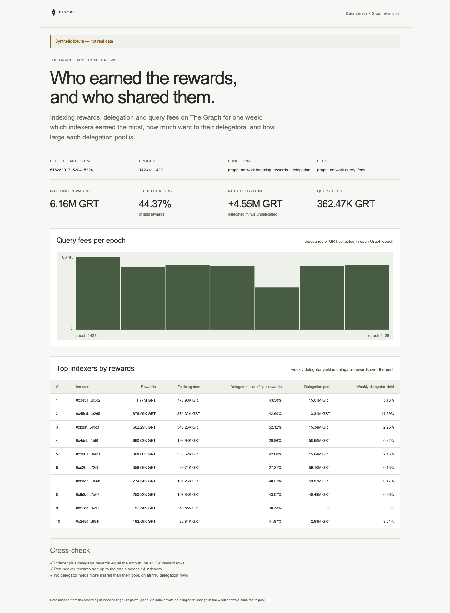

# Graph economy

One week of The Graph on Arbitrum: which indexers earned the most indexing
rewards, how much of that went to their delegators, how large each indexer's
delegation pool is, and how many query fees the network collected in each Graph
epoch. The page proves its numbers: on every reward row indexer plus delegator
rewards must equal the amount, and per-indexer rewards must add up to the totals.

**The shipped recording is synthetic.** `recordings/report.json` is generated
by `test/fixture.mjs` and the page says so in its banner. Record real data with
`tools/prepare` (below).



## Prerequisites

- Node.js 22.13 or later

## Run

Working directory: `demos/graph-economy`

```sh
npm ci
npm start
```

Open http://127.0.0.1:4180 (set `PORT` to change it). Expected result: the
synthetic banner, four headline numbers, query fees per epoch as bars, a table
of the top 10 indexers by rewards with delegators' cut, delegation pool and
delegator yield, and three passed cross-checks.

## Test

```sh
npm test
npx playwright install chromium
npm run test:browser
npm run lint
npm run format:check
```

`npm test` checks the cross-check passes on the fixture and fails when an
indexer share is in whole GRT instead of wei, when a reward log is counted
twice, or when a delegator holds more shares than the pool; and that the
shaped report ranks indexers, takes each pool from the last delegation row,
credits a reward to the indexer its row names and subtracts undelegations. `npm run test:browser`
writes `docs/screenshot-desktop.png`. `npm run fixture` regenerates the
synthetic recording.

## Subjects and window

All amounts are wei of GRT (18 decimals). The contracts are The Graph Horizon
deployment on Arbitrum One (chain 42161). Each address was read from the
protocol's Controller (`0x0a8491544221dd212964fbb96487467291b2c97e`) with
`getContractProxy`, and the RewardsManager's `subgraphService()` returns the
SubgraphService below.

| Subject         | Address                                      | Note                                    |
| --------------- | -------------------------------------------- | --------------------------------------- |
| HorizonStaking  | `0x00669a4cf01450b64e8a2a20e9b1fcb71e61ef03` | Controller `Staking`                    |
| EpochManager    | `0x5a843145c43d328b9bb7a4401d94918f131bb281` | Controller `EpochManager`               |
| RewardsManager  | `0x971b9d3d0ae3eca029cab5ea1fb0f72c85e6a525` | Controller `RewardsManager`             |
| SubgraphService | `0xb2bb92d0de618878e438b55d5846cfecd9301105` | named by RewardsManager.subgraphService |
| GraphPayments   | `0x7aae8ae011927bc36cb4d0d3e81f2e6e30dae06d` | Controller `GraphPayments`              |

Window: Arbitrum blocks `[518282017, 520415225)`, the seven UTC days
2026-10-26 to 2026-11-01. Both ends were confirmed by block timestamp: 518282017 is 2026-10-26 00:00:00 UTC (its predecessor is 2026-10-25 23:59:59) and 520415225 is 2026-11-02 00:00:00 UTC. Both ends are the first block at or after midnight
UTC (2026-10-26 and 2026-11-02), found by binary search over the public
Arbitrum RPC, not through Testril.

## Binds (`testril.json`)

Windows are half-open: the end is the first block not included.

| Name               | Function                         | Chain | Params                                                            | Window                |
| ------------------ | -------------------------------- | ----- | ----------------------------------------------------------------- | --------------------- |
| `indexing-rewards` | `graph_network.indexing_rewards` | 42161 | `rewards_manager`, `subgraph_service`, `staking`, `epoch_manager` | 518282017 → 520415225 |
| `delegation`       | `graph_network.delegation`       | 42161 | `staking`, `epoch_manager`                                        | 518282017 → 520415225 |
| `query-fees`       | `graph_network.query_fees`       | 42161 | `staking`, `subgraph_service`, `graph_payments`, `epoch_manager`  | 518282017 → 520415225 |

Each bind is read in chunks of 100000 blocks.

## Record real data

Recording needs `tools/prepare` from this repository and a Testril operator
key with a funded channel; neither is part of an extracted demo. Recording
signs payment vouchers only and never deposits. From the repository root:

```sh
cd tools/prepare && npm ci && cp .env.example .env   # set TESTRIL_MCP_URL and TESTRIL_OPERATOR_KEY
node prepare.mjs --plan ../../demos/graph-economy   # free estimate
cd ../../demos/graph-economy && npm run record
```

`npm run record` replaces `recordings/report.json` with `source: "dev"`, the
bound function ids, job ids and timings. The page then shows "Recorded from
Testril on <date>".
