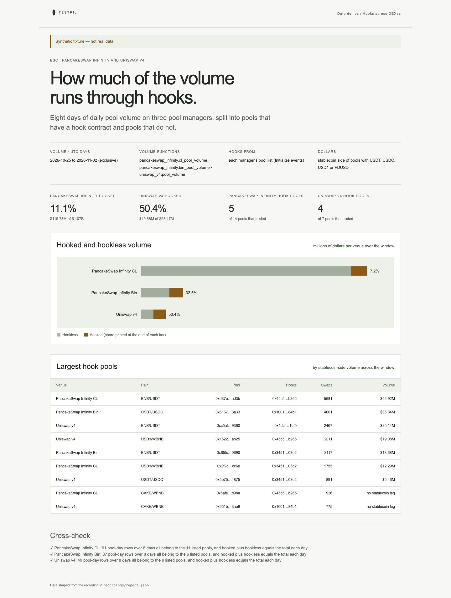

# Hooks across DEXes

Daily pool volume on BSC for 2026-10-25 to 2026-11-01 on three pool managers:
PancakeSwap Infinity CL, PancakeSwap Infinity Bin and Uniswap v4. Each pool is
read from its manager's pool list, called hooked when its `hooks` address is
not the zero address, and its volume is split into hooked and hookless. The page
proves its numbers: every traded pool must be in its pool list, have at most
one row per day, and on each day hooked plus hookless must equal the total,
with every pool counted in exactly one class.

**The shipped recording is synthetic.** `recordings/synthetic.json` is generated
by `test/fixture.mjs` and the page says so in its banner. Record real data with
`npm run record` (below).



## Prerequisites

- Node.js 22.13 or later

## Run

Working directory: `demos/hooks-across-dexes`

```sh
npm ci
npm start
```

Open http://127.0.0.1:4180 (set `PORT` to change it). Expected result: the
synthetic banner, hooked share and hook pool counts per DEX, a bar per venue
split into hooked and hookless dollars, a table of up to ten of the largest hook pools,
and three passed cross-checks.

## Test

```sh
npm test
npx playwright install chromium
npm run test:browser
npm run lint
npm run format:check
```

`npm test` checks the cross-check passes on the fixture and fails when a traded
pool is missing from the pool list, a pool is listed twice, a pool has two rows
for one day, a row is outside the window, the legs of a stablecoin pair differ
by more than 1%, a hookless pool has a non-zero hooks_registration, a pool counts
as both or neither of hooked and hookless, and that a failed cross-check still
renders on the page, and that the report splits hooked
from hookless volume on the stablecoin side of each pool. `npm run test:browser`
writes `docs/screenshot-desktop.png`. `npm run fixture` regenerates the
synthetic recording.

Assumptions to verify on the first real recording: the 1% leg check applies
only to hookless stablecoin pairs (a hooked pool's swap delta or dynamic fee
can legitimately widen the gap), and for hooked pools `hooks_registration` is
not checked because a hook may register a zero bitmap. Uniswap v4's pool list
has no `hooks_registration`, so that check runs only on PancakeSwap Infinity.

## How dollars are counted

`volume0` and `volume1` are raw amounts of two different tokens, so they cannot
be added across pools. The page counts the stablecoin side only: for a pool with
USDT, USDC, USD1 or FDUSD (all 18 decimals on BSC) it uses that currency's
volume, which is the dollar value traded. Pools with no stablecoin (for example
WBNB/CAKE) add to swap counts but not to dollars.

## Subjects and window

- Volume: UTC days `[2026-10-25, 2026-11-02)`.
- Pool lists: from each manager's creation block to block 131141195, the first
  block of 2026-11-02, so every pool that traded in the window is listed.
  Creation blocks and the day boundary were found by binary search over public
  BSC RPC endpoints, not through Testril; verify them before recording.

| Subject                             | Address                                      | Note                                         |
| ----------------------------------- | -------------------------------------------- | -------------------------------------------- |
| PancakeSwap Infinity CLPoolManager  | `0xa0ffb9c1ce1fe56963b0321b32e7a0302114058b` | verify before recording; created at 47214308 |
| PancakeSwap Infinity BinPoolManager | `0xc697d2898e0d09264376196696c51d7abbbaa4a9` | verify before recording; created at 47214336 |
| Uniswap v4 PoolManager (BSC)        | `0x28e2ea090877bf75740558f6bfb36a5ffee9e9df` | verify before recording; created at 45970610 |
| USDT (BSC)                          | `0x55d398326f99059ff775485246999027b3197955` |                                              |
| USDC (BSC)                          | `0x8ac76a51cc950d9822d68b83fe1ad97b32cd580d` |                                              |
| USD1                                | `0x8d0d000ee44948fc98c9b98a4fa4921476f08b0d` | verify before recording                      |
| FDUSD                               | `0xc5f0f7b66764f6ec8c8dff7ba683102295e16409` | verify before recording                      |

The managers hold bytecode at those addresses on BSC; that they are the
PancakeSwap and Uniswap deployments is not confirmed.

## Binds (`testril.json`)

Windows are half-open: the end is the first block or day not included.

| Name         | Function                               | Chain | Params       | Window                  |
| ------------ | -------------------------------------- | ----- | ------------ | ----------------------- |
| `cl-volume`  | `pancakeswap_infinity.cl_pool_volume`  | 56    | `swap`, `by` | 2026-10-25 → 2026-11-02 |
| `cl-pools`   | `pancakeswap_infinity.cl_pool_list`    | 56    | `manager`    | 47214308 → 131141195    |
| `bin-volume` | `pancakeswap_infinity.bin_pool_volume` | 56    | `swap`, `by` | 2026-10-25 → 2026-11-02 |
| `bin-pools`  | `pancakeswap_infinity.bin_pool_list`   | 56    | `manager`    | 47214336 → 131141195    |
| `v4-volume`  | `uniswap_v4.pool_volume`               | 56    | `swap`, `by` | 2026-10-25 → 2026-11-02 |
| `v4-pools`   | `uniswap_v4.pool_list`                 | 56    | `manager`    | 45970610 → 131141195    |

Pool lists are read in chunks of 10,000,000 blocks.

## Record real data

The demo records itself. It needs a private key whose address holds Testril
usage credits; it pays with vouchers against those credits, so the wallet
needs no USDC.

| Variable            | Purpose                                                    |
| ------------------- | ---------------------------------------------------------- |
| `TESTRIL_PAYER_KEY` | Hex private key that signs vouchers; required to record    |
| `TESTRIL_MCP_URL`   | Testril MCP endpoint; default `https://dev.testril.ai/mcp` |

Working directory: `demos/hooks-across-dexes`

```sh
export TESTRIL_PAYER_KEY=<hex private key>
npm run record
```

For each bind in `testril.json`, `npm run record` calls `bind`, asks
`materialize` for the whole window (Testril charges only for blocks not yet
indexed), waits for the job, then `read`s the window. It writes
`recordings/recorded.json` (git-ignored) with `source: "dev"`, the bound
function ids, job ids, timings and the usage credits spent. The page then
shows "Recorded from Testril on <date>". A failed run leaves the previous
recording in place.

`npm test` runs `npm run record` against a fake Testril: it pays with the
payer's vouchers, follows each `materialize` answer and keeps every row.
