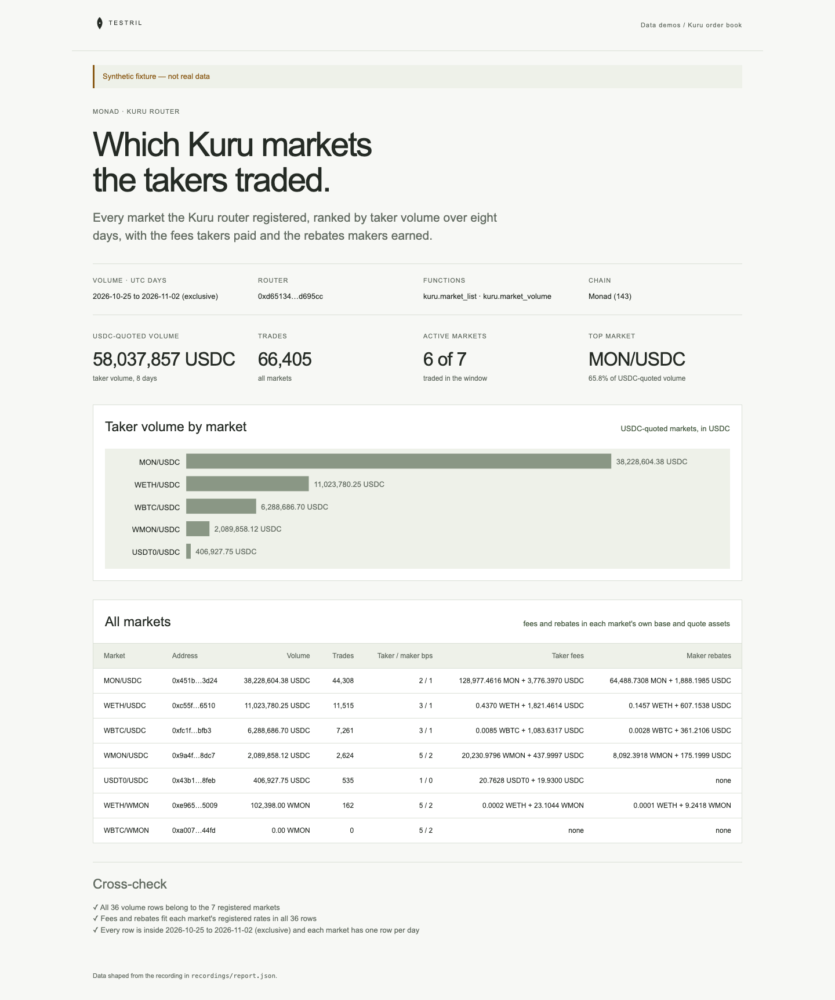

# Kuru order book

Every market the Kuru router registered on Monad, ranked by taker volume over
eight days, with the fees takers paid and the rebates makers earned. The page
proves its numbers: every volume row must belong to a registered market, fees
and rebates must be non-negative, and each market has one row per day inside the
window.

**The shipped recording is synthetic.** `recordings/report.json` is generated
by `test/fixture.mjs` and the page says so in its banner. Record real data with
`tools/prepare` (below).



## Prerequisites

- Node.js 22.13 or later

## Run

Working directory: `demos/kuru-orderbook`

```sh
npm ci
npm start
```

Open http://127.0.0.1:4180 (set `PORT` to change it). Expected result: the
synthetic banner, four headline numbers, a bar chart of taker volume for the
USDC-quoted markets, a table of all markets with fees and rebates, and three
passed cross-checks.

## Test

```sh
npm test
npx playwright install chromium
npm run test:browser
npm run lint
npm run format:check
```

`npm test` checks the cross-check passes on the fixture and fails on an
unregistered market, a negative rebate, a duplicate market-day and a row outside
the window, and that the server returns the shaped report. `npm run test:browser`
writes `docs/screenshot-desktop.png`. `npm run fixture` regenerates the
synthetic recording.

## Subjects and window

- Kuru router on Monad (chain 143)
  `0xd651346d7c789536ebf06dc72ae3c8502cd695cc` (verify before recording).
- USDC on Monad `0x754704bc059f8c67012fed69bc8a327a5aafb603` (verify before
  recording). Markets quoted in it are ranked and charted together; markets
  quoted in another asset are listed after them, in that asset.
- Symbols for WMON, WETH, WBTC and USDT0 come from fixed addresses in
  `src/report.mjs` (verify before recording); other assets show shortened hex.
- Volume: UTC days `[2026-10-25, 2026-11-02)`, so 2026-10-25 to 2026-11-01. The
  daemon's `to_day` is exclusive.
- Markets: blocks `[0, 118765043)`. The router's registrations are read from
  the start of the chain so every market that traded in the window is listed;
  `118765043` was the Monad head when the demo was planned.

Volumes, fees and rebates are whole tokens with 18 decimals whatever the token's
own decimals; the page divides by 10^18.

## Binds (`testril.json`)

Windows are half-open: the end is the first block or day not included.

| Name      | Function             | Chain | Params                       | Window                  |
| --------- | -------------------- | ----- | ---------------------------- | ----------------------- |
| `markets` | `kuru.market_list`   | 143   | `router`                     | 0 → 118765043           |
| `volume`  | `kuru.market_volume` | 143   | `swap.market_list`, `by` day | 2026-10-25 → 2026-11-02 |

`volume` depends on the router's `kuru.trade` rows, which depend on
`kuru.market_list`. The estimate from `tools/prepare --plan` counts blocks in
the windows only; both functions are indexed from the router's creation and cost
more than the estimate.

## Record real data

Recording needs `tools/prepare` from this repository and a Testril operator
key with a funded channel; neither is part of an extracted demo. From the
repository root:

```sh
cd tools/prepare && npm ci && cp .env.example .env   # set TESTRIL_MCP_URL and TESTRIL_OPERATOR_KEY
node prepare.mjs --plan ../../demos/kuru-orderbook   # free estimate
cd ../../demos/kuru-orderbook && npm run record
```

`npm run record` replaces `recordings/report.json` with `source: "dev"`, the
bound function ids, job ids and timings. The page then shows "Recorded from
Testril on <date>".
