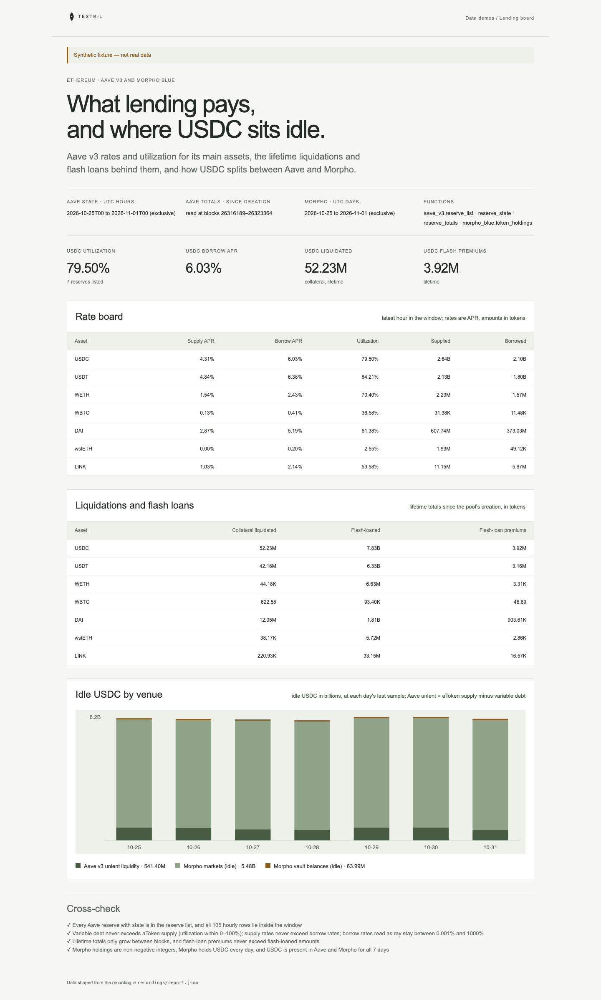

# Lending board

Aave v3 rates and utilization per asset on Ethereum, the lifetime liquidations
and flash loans behind them, and how much USDC sits idle in Aave (aToken supply minus variable debt),
Morpho markets and MetaMorpho v1 vaults. The page proves its numbers: variable debt never
exceeds aToken supply, supply rates never exceed borrow rates, rates read as
ray stay plausible, lifetime totals only grow, and Morpho holdings are not
negative.

**The shipped recording is synthetic.** `recordings/report.json` is generated
by `test/fixture.mjs` and the page says so in its banner. To keep it small the
fixture holds seven assets sampled twice a day plus the window's last hour.
Record real data with `tools/prepare` (below).



## Prerequisites

- Node.js 22.13 or later

## Run

Working directory: `demos/lending-board`

```sh
npm ci
npm start
```

Open http://127.0.0.1:4180 (set `PORT` to change it). Expected result: the
synthetic banner, four USDC headline numbers, a rate board, a lifetime
liquidations and flash-loan table, a stacked bar of idle USDC per day, and four
passed cross-checks.

## Test

```sh
npm test
npx playwright install chromium
npm run test:browser
npm run lint
npm run format:check
```

`npm test` checks the cross-checks pass on the fixture and fail when debt and
supply are swapped, when rates carry nine extra digits or lose nine, when a lifetime total
falls, when Morpho holdings are negative, fractional or empty of USDC, or when an asset misses the last hour,
and that the server returns the shaped report. `npm run test:browser` writes
`docs/screenshot-desktop.png`. `npm run fixture` regenerates the recording.

## Subjects and window

| Subject                                | Address                                                 | Note                    |
| -------------------------------------- | ------------------------------------------------------- | ----------------------- |
| Aave v3 Ethereum PoolAddressesProvider | `0x2f39d218133afab8f2b819b1066c7e434ad94e9e`            |                         |
| Morpho Blue                            | `0xbbbbbbbbbb9cc5e90e3b3af64bdaf62c37eeffcb`            |                         |
| MetaMorpho factory v1.1                | `0xa9c3d3a366466fa809d1ae982fb2c46e5fc41101`            | verify before recording |
| MetaMorpho factory v1.0                | `0x1897a8997241c1cd4bd0698647e4eb7213535c24`            | verify before recording |
| Morpho vault factory v2                | not bound: `in_vaults` covers MetaMorpho v1 vaults only |                         |
| USDC (6 decimals)                      | `0xa0b86991c6218b36c1d19d4a2e9eb0ce3606eb48`            |                         |
| USDT (6)                               | `0xdac17f958d2ee523a2206206994597c13d831ec7`            |                         |
| WETH (18)                              | `0xc02aaa39b223fe8d0a0e5c4f27ead9083c756cc2`            |                         |
| WBTC (8)                               | `0x2260fac5e5542a773aa44fbcfedf7c193bc2c599`            |                         |
| DAI (18)                               | `0x6b175474e89094c44da98b954eedeac495271d0f`            |                         |
| wstETH (18)                            | `0x7f39c581f595b53c5cb19bd0b3f8da6c935e2ca0`            |                         |
| LINK (18)                              | `0x514910771af9ca656af840dff83e8264ecf986ca`            |                         |

The page shows the seven assets above; a real read returns every Aave reserve.

- Aave state: UTC hours `[2026-10-25T00, 2026-11-01T00)`, read at each hour's
  last block. Rates are APR (the daemon's per-year ray), shown to 0.01%.
- Aave totals: lifetime sums since the pool's creation. A one-day block window
  `[26316189, 26323365)` (about Ethereum 2026-11-01, estimated at 7,200 blocks a day: verify before recording) is enough, because a read carries
  each reserve's last row from before its window.
- Aave reserve list: from block 16291000 (verify before recording: the
  provider's creation block).
- Morpho: UTC days `[2026-10-25, 2026-11-01)`. "Vault balances" are the
  vaults' idle balance of the token, not their deposits in markets, and cover
  MetaMorpho v1 vaults only (no Vault V2 factory is bound).

## Binds (`testril.json`)

Windows are half-open: the end is the first block, hour or day not included.

| Name              | Function                     | Chain | Params                                           | Window                        |
| ----------------- | ---------------------------- | ----- | ------------------------------------------------ | ----------------------------- |
| `reserves`        | `aave_v3.reserve_list`       | 1     | `proxy_list`                                     | 16291000 → 26323365           |
| `reserve-state`   | `aave_v3.reserve_state`      | 1     | `proxy_list`, `reserve_list`, `by`               | 2026-10-25T00 → 2026-11-01T00 |
| `reserve-totals`  | `aave_v3.reserve_totals`     | 1     | `proxy_list`                                     | 26316189 → 26323365           |
| `morpho-holdings` | `morpho_blue.token_holdings` | 1     | `morpho_blue`, `market_list`, `vault_list`, `by` | 2026-10-25 → 2026-11-01       |

## Record real data

Recording needs `tools/prepare` from this repository and a Testril operator
key with a funded channel; neither is part of an extracted demo. From the
repository root:

```sh
cd tools/prepare && npm ci && cp .env.example .env   # set TESTRIL_MCP_URL and TESTRIL_OPERATOR_KEY
node prepare.mjs --plan ../../demos/lending-board   # free estimate
cd ../../demos/lending-board && npm run record
```

`npm run record` replaces `recordings/report.json` with `source: "dev"`, the
bound function ids, job ids and timings. The page then shows "Recorded from
Testril on <date>".
