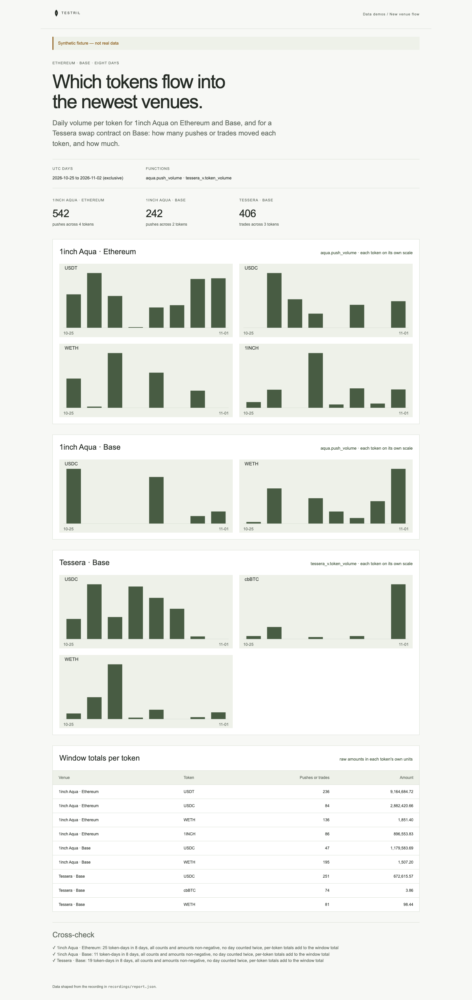

# New venue flow

Daily volume per token for two newer venues over eight days: the 1inch Aqua
registry on Ethereum and Base, and a Tessera swap contract on Base. Each venue
gets one bar chart per token, with a table of window totals. The page proves
its numbers: counts and amounts are non-negative integers, no token-day is
counted twice, every day lies in the window, and the per-token totals add up to
the total of all rows.

**The shipped recording is synthetic.** `recordings/report.json` is generated
by `test/fixture.mjs` and the page says so in its banner. Record real data with
`tools/prepare` (below).



## Prerequisites

- Node.js 22.13 or later

## Run

Working directory: `demos/new-venue-flow`

```sh
npm ci
npm start
```

Open http://127.0.0.1:4180 (set `PORT` to change it). Expected result: the
synthetic banner, three headline counts, a bar chart per token for each of the
three venues, a table of window totals, and three passed cross-checks.

## Test

```sh
npm test
npx playwright install chromium
npm run test:browser
npm run lint
npm run format:check
```

`npm test` checks the cross-check passes on the fixture and fails on a
negative amount, a token-day counted twice, a day outside the window, and an
amount in decimal instead of raw units, and that amounts of 6- and 18-decimal
tokens are scaled apart. `npm run test:browser` writes
`docs/screenshot-desktop.png`. `npm run fixture` regenerates the synthetic
recording.

## Subjects and window

- UTC days `[2026-10-25, 2026-11-02)`: 25 October to 1 November. The end day is
  exclusive on the daemon.
- Amounts are raw token units, never priced, so each token has its own scale.
  Tokens missing from the table in `src/report.mjs` show as a shortened address
  in raw units.

| Subject                                   | Address                                      | Note                                                         |
| ----------------------------------------- | -------------------------------------------- | ------------------------------------------------------------ |
| 1inch Aqua registry (same on both chains) | `0x499943e74fb0ce105688beee8ef2abec5d936d31` | verify before recording                                      |
| Tessera swap contract on Base             | `0x0000000000000000000000000000000000000001` | placeholder: replace with the real contract before recording |

## Binds (`testril.json`)

| Name            | Function                 | Chain | Params                    | Window                  |
| --------------- | ------------------------ | ----- | ------------------------- | ----------------------- |
| `aqua-ethereum` | `aqua.push_volume`       | 1     | `swap.registry`, `by`     | 2026-10-25 → 2026-11-02 |
| `aqua-base`     | `aqua.push_volume`       | 8453  | `swap.registry`, `by`     | 2026-10-25 → 2026-11-02 |
| `tessera-base`  | `tessera_v.token_volume` | 8453  | `swap.swap_address`, `by` | 2026-10-25 → 2026-11-02 |

## Record real data

Recording needs `tools/prepare` from this repository and a Testril operator
key with a funded channel; neither is part of an extracted demo. From the
repository root:

```sh
cd tools/prepare && npm ci && cp .env.example .env   # set TESTRIL_MCP_URL and TESTRIL_OPERATOR_KEY
node prepare.mjs --plan ../../demos/new-venue-flow   # free estimate
cd ../../demos/new-venue-flow && npm run record
```

`npm run record` replaces `recordings/report.json` with `source: "dev"`, the
bound function ids, job ids and timings. The page then shows "Recorded from
Testril on <date>".
