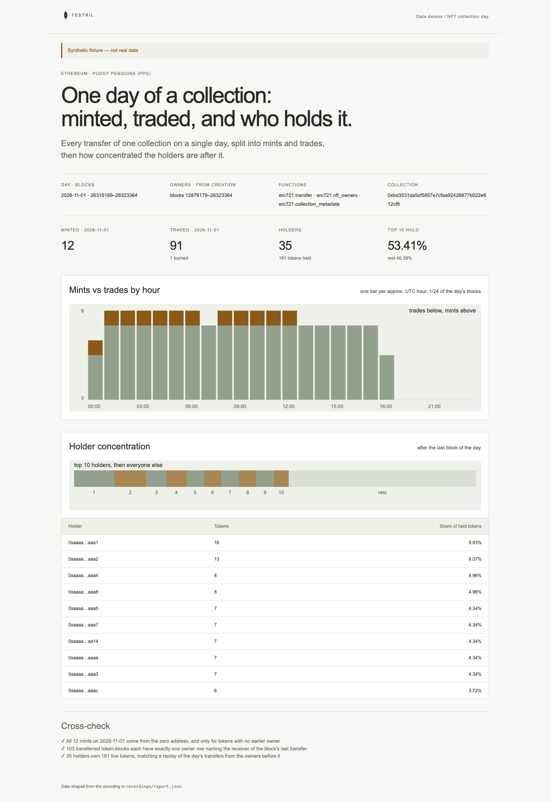

# NFT collection day

One day of a blue-chip ERC-721 collection on Ethereum: how many tokens were
minted and how many traded, hour by hour, and how concentrated the holders are
after the last block of the day. The page proves its numbers with three
cross-checks: mints come from the zero address and only for tokens with no
earlier owner, every transferred token has exactly one owner row per block
naming the receiver of that block's last transfer, and the holder balances
match the distinct owners in the owner rows.

**The shipped recording is synthetic.** `recordings/report.json` is generated
by `test/fixture.mjs` (a small made-up collection, not Pudgy Penguins' real
history) and the page says so in its banner. Record real data with
`tools/prepare` (below).



## Prerequisites

- Node.js 22.13 or later

## Run

Working directory: `demos/nft-collection-day`

```sh
npm ci
npm start
```

Open http://127.0.0.1:4180 (set `PORT` to change it). Expected result: the
synthetic banner, four headline numbers, a mints-vs-trades bar per approximate UTC hour (the day's blocks split into 24 equal parts), a
top-10 holder concentration bar with a table, and three passed cross-checks.

## Test

```sh
npm test
npx playwright install chromium
npm run test:browser
npm run lint
npm run format:check
```

`npm test` checks the cross-checks pass on the fixture and fail when a mint
comes from a holder, when a token with an earlier owner is called a mint, when
an owner row is missing or duplicated, when a double transfer in one block
names the wrong owner, and when a transfer's sender is not the token's owner, and that the server returns the shaped report.
`npm run test:browser` writes `docs/screenshot-desktop.png`.
`npm run fixture` regenerates the synthetic recording.

## Subjects and window

| Subject         | Address                                      | Note                                           |
| --------------- | -------------------------------------------- | ---------------------------------------------- |
| Pudgy Penguins  | `0xbd3531da5cf5857e7cfaa92426877b022e612cf8` | verify before recording                        |
| Collection born | block 12876179                               | verify before recording (start of owners read) |

- Day: 2026-11-01, blocks `[26316189, 26323365)`, found by binary search over a
  public RPC; verify before recording.
- Pudgy Penguins finished minting in 2021, so a real recording shows 0 mints and
  the mint cross-check has nothing to test; the synthetic fixture has 12.
- Owners: from the collection's creation to the end of that day, so the last
  row per token is who holds it afterwards.
- Names: `erc721.collection_metadata` read at block 26323364.

## Binds (`testril.json`)

Windows are half-open: the end is the first block not included.

| Name        | Function                     | Chain | Params        | Window              |
| ----------- | ---------------------------- | ----- | ------------- | ------------------- |
| `metadata`  | `erc721.collection_metadata` | 1     | `nft_address` | 26323364 → 26323365 |
| `transfers` | `erc721.transfer`            | 1     | `nft_address` | 26316189 → 26323365 |
| `owners`    | `erc721.nft_owners`          | 1     | `nft_address` | 12876179 → 26323365 |

`transfers` is read in chunks of 1,200 blocks and `owners` in chunks of
1,000,000 blocks.

## Record real data

Recording needs `tools/prepare` from this repository and a Testril operator
key with a funded channel; neither is part of an extracted demo. From the
repository root:

```sh
cd tools/prepare && npm ci && cp .env.example .env   # set TESTRIL_MCP_URL and TESTRIL_OPERATOR_KEY
node prepare.mjs --plan ../../demos/nft-collection-day   # free estimate
cd ../../demos/nft-collection-day && npm run record
```

`npm run record` replaces `recordings/report.json` with `source: "dev"`, the
bound function ids, job ids and timings. The page then shows "Recorded from
Testril on <date>".
