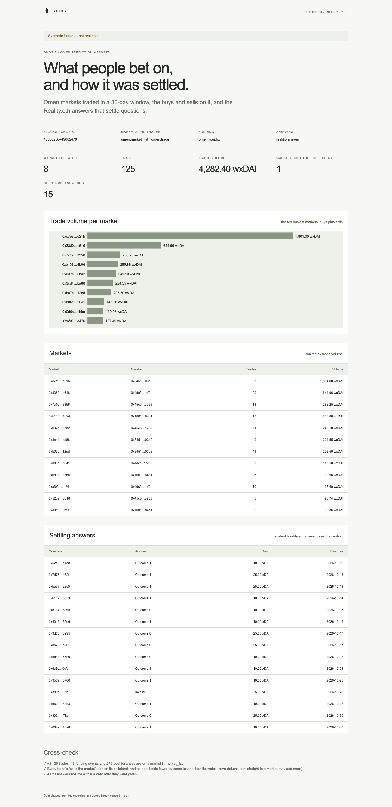

# Omen markets

Prediction markets on Gnosis Chain for 30 days: every market the Omen factory
has created (so trades on older markets are listed too), the buys and sells on
each, the funding added, the outcome tokens each market's pool holds, and the
Reality.eth answers that settle questions. The page counts the markets created
in the window and ranks wxDAI markets by trade volume; markets on other
collateral (for example USDC, 6 decimals) are listed apart, never summed into
the wxDAI total. Reality.eth bonds are in native xDAI. It proves its numbers:
every trade, funding event and pool balance must be on a listed market, every
trade's fee must equal the market's fee on its collateral, no answer may
finalize before it was given, and no pool may hold negative outcome tokens. A
pool's balance must also follow its trades: at a block with trades and no
funding, each outcome moves by the collateral less fee paid in (buy) or the
collateral plus fee paid out (sell) on every outcome, and by the tokens traded
on the traded outcome. The scope is the market's pool, not a trader's
holdings: a trader may sell tokens bought before the window or obtained by
splitting a position, so sells are not matched against buys. A balance read
after tokens sent straight to a market can exceed what its trades leave.

Reality.eth answers are keyed by question id, and none of the five functions
links a market to its question, so answers are listed beside the markets, not
joined to them.

**The shipped recording is synthetic.** `recordings/report.json` is generated
by `test/fixture.mjs` and the page says so in its banner. Record real data with
`tools/prepare` (below).



## Prerequisites

- Node.js 22.13 or later

## Run

Working directory: `demos/omen-markets`

```sh
npm ci
npm start
```

Open http://127.0.0.1:4180 (set `PORT` to change it). Expected result: the
synthetic banner, five headline numbers, a bar chart of the ten busiest
markets, a table of markets, a table of settling answers, and three passed
cross-checks.

## Test

```sh
npm test
npx playwright install chromium
npm run test:browser
npm run lint
npm run format:check
```

`npm test` checks the cross-check passes on the fixture and fails on a trade
for an unlisted market, buys read as sells, a fee off by 10^2, a pool balance
that holds fewer tokens than its trades leave or is negative, and an answer that finalizes
before it was given; that the report counts only window markets, keeps
non-wxDAI collateral out of the wxDAI total and survives an unlisted market;
and that the server returns the shaped report. `npm run test:browser` writes `docs/screenshot-desktop.png`.
`npm run fixture` regenerates the synthetic recording.

## Subjects and window

Window: Gnosis blocks `[48558286, 49062480)`, the first block at or after
2026-10-03T00:00Z up to the first block of 2026-11-02 (30 days ending
2026-11-01), found by binary search over the public RPC
gnosis-rpc.publicnode.com.

| Subject                              | Address                                      | Note                    |
| ------------------------------------ | -------------------------------------------- | ----------------------- |
| Omen FPMM deterministic factory      | `0x9083a2b699c0a4ad06f63580bde2635d26a3eef0` |                         |
| Conditional Tokens                   | `0xceafdd6bc0bef976fdcd1112955828e00543c0ce` |                         |
| Reality.eth (Realitio) on Gnosis     | `0x79e32ae03fb27b07c89c0c568f80287c01ca2e57` | verify before recording |
| wxDAI (collateral counted in volume) | `0xe91d153e0b41518a2ce8dd3d7944fa863463a97d` |                         |

The factory, Conditional Tokens and wxDAI addresses are the well-known Omen
on Gnosis deployments; only the Reality.eth address is
unconfirmed as the instance Omen uses.

## Binds (`testril.json`)

Windows are half-open: the end is the first block not included.

| Name           | Function            | Chain | Params                          | Window              |
| -------------- | ------------------- | ----- | ------------------------------- | ------------------- |
| `markets`      | `omen.market_list`  | 100   | `factory`, `conditional_tokens` | 0 → 49062480        |
| `trades`       | `omen.trade`        | 100   | `market_list`                   | 48558286 → 49062480 |
| `liquidity`    | `omen.liquidity`    | 100   | `market_list`                   | 48558286 → 49062480 |
| `market_state` | `omen.market_state` | 100   | `market_list`                   | 48558286 → 49062480 |
| `answers`      | `realitio.answer`   | 100   | `realitio`                      | 48558286 → 49062480 |

`market_state` is a bind the first plan did not list; the check that no pool
holds negative or too few outcome tokens needs it, at the cost of its credits.
`markets` starts at block 0 so it lists every market that can trade in the
window, not only those created in it. `trades`, `liquidity`, `market_state` and
`answers` are read in chunks of 20,000 blocks.

## Record real data

Recording needs `tools/prepare` from this repository and a Testril operator
key with an existing funded channel (it signs vouchers only and never
deposits); neither is part of an extracted demo. From the repository root:

```sh
cd tools/prepare && npm ci && cp .env.example .env   # set TESTRIL_MCP_URL and TESTRIL_OPERATOR_KEY
node prepare.mjs --plan ../../demos/omen-markets   # free estimate
cd ../../demos/omen-markets && npm run record
```

`npm run record` replaces `recordings/report.json` with `source: "dev"`, the
bound function ids, job ids and timings. The page then shows "Recorded from
Testril on <date>".
