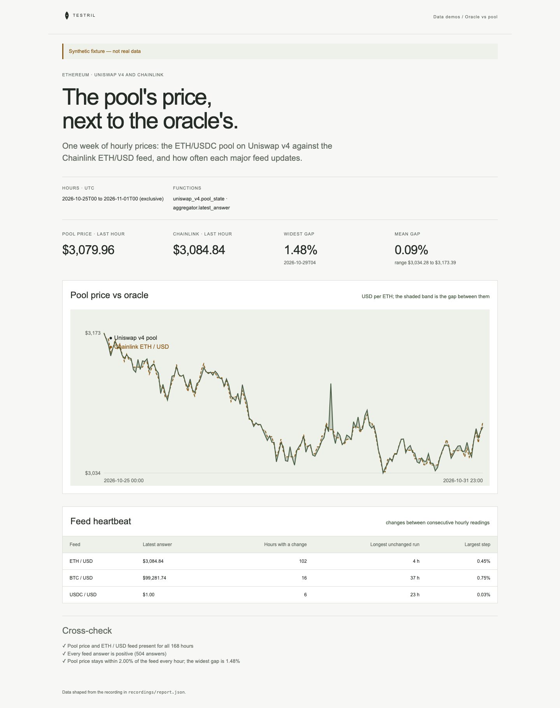

# Oracle vs pool

One week of hourly prices on Ethereum: the ETH/USDC pool on Uniswap v4 next to
the Chainlink ETH/USD feed, with the gap between them, and a heartbeat table
for ETH/USD, BTC/USD and USDC/USD. The page proves its numbers: the pool price,
rebuilt from `sqrt_price_x96` with BigInt math and token decimals applied, must
be within 2% of the Chainlink answer in every hour, and every feed answer must
be positive.

**The shipped recording is synthetic.** `recordings/report.json` is generated
by `test/fixture.mjs` and the page says so in its banner. Record real data with
`tools/prepare` (below).



## Prerequisites

- Node.js 22.13 or later

## Run

Working directory: `demos/oracle-vs-pool`

```sh
npm ci
npm start
```

Open http://127.0.0.1:4180 (set `PORT` to change it). Expected result: the
synthetic banner, four headline numbers, a two-line chart of pool price against
oracle price with the gap shaded, a three-row feed heartbeat table, and three
passed cross-checks.

## Test

```sh
npm test
npx playwright install chromium
npm run test:browser
npm run lint
npm run format:check
```

`npm test` checks the cross-check passes on the fixture and fails when the pool
price is inverted, when token decimals are left out, when one hour drifts 3%
from the feed, when a feed answer is not positive, or when an hour is missing,
and that the server returns the shaped report. `npm run test:browser` writes
`docs/screenshot-desktop.png`. `npm run fixture` regenerates the synthetic
recording.

## Subjects and window

- Hours: `[2026-10-25T00, 2026-11-01T00)`, 168 UTC hours, each read at the
  hour's last block.
- The pool is ETH (currency0, 18 decimals) against USDC (currency1, 6
  decimals), so USD per ETH is `sqrt_price_x96² / 2¹⁹² × 10¹²`.
- Feeds answer with 8 decimals.

| Subject                       | Address                                                              | Note                    |
| ----------------------------- | -------------------------------------------------------------------- | ----------------------- |
| Uniswap v4 PoolManager        | `0x000000000004444c5dc75cb358380d2e3de08a90`                         |                         |
| ETH/USDC pool id (0.05%)      | `0x21c67e77068de97969ba93d4aab21826d33ca12bb9f565d8496e8fda8a82ca27` | verify before recording |
| Chainlink ETH/USD aggregator  | `0x5f4ec3df9cbd43714fe2740f5e3616155c5b8419`                         | verify before recording |
| Chainlink BTC/USD aggregator  | `0xf4030086522a5beea4988f8ca5b36dbc97bee88c`                         | verify before recording |
| Chainlink USDC/USD aggregator | `0x8fffffd4afb6115b954bd326cbe7b4ba576818f6`                         | verify before recording |

## Binds (`testril.json`)

Windows are half-open: the end is the first hour not included.

| Name    | Function                   | Chain | Params                  | Window                        |
| ------- | -------------------------- | ----- | ----------------------- | ----------------------------- |
| `pool`  | `uniswap_v4.pool_state`    | 1     | `manager`, `pool`, `by` | 2026-10-25T00 → 2026-11-01T00 |
| `feeds` | `aggregator.latest_answer` | 1     | `feeds`, `by`           | 2026-10-25T00 → 2026-11-01T00 |

## Record real data

Recording needs `tools/prepare` from this repository and a Testril operator
key with a funded channel; neither is part of an extracted demo. From the
repository root:

```sh
cd tools/prepare && npm ci && cp .env.example .env   # set TESTRIL_MCP_URL and TESTRIL_OPERATOR_KEY
node prepare.mjs --plan ../../demos/oracle-vs-pool   # free estimate
cd ../../demos/oracle-vs-pool && npm run record
```

`npm run record` replaces `recordings/report.json` with `source: "dev"`, the
bound function ids, job ids and timings. The page then shows "Recorded from
Testril on <date>".
