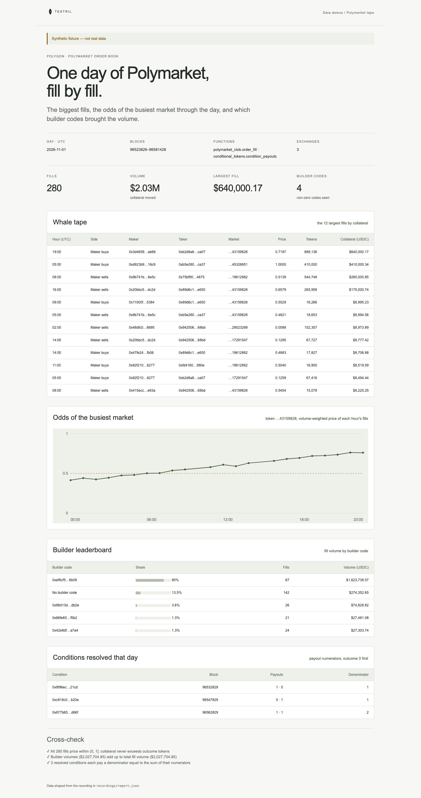

# Polymarket tape

One UTC day of Polymarket order-book fills on Polygon: the largest fills
(whale tape), the implied odds of the busiest market per hour, and fill volume
by builder code, plus the conditions that resolved that day. The page proves
its numbers: every fill prices within (0, 1] (collateral over outcome tokens,
compared as integers), every fee is booked in the asset its version and side
require, builder volumes and the leaderboard (top 8 plus other builders) add up
to the total, and each resolved condition pays a denominator equal to the sum of
its numerators.

**The shipped recording is synthetic.** `recordings/synthetic.json` is generated
by `test/fixture.mjs` and the page says so in its banner. Record real data with
`npm run record` (below).



## Prerequisites

- Node.js 22.13 or later

## Run

Working directory: `demos/polymarket-tape`

```sh
npm ci
npm start
```

Open http://127.0.0.1:4180 (set `PORT` to change it). Expected result: the
synthetic banner, four headline numbers, a table of the 12 largest fills, an
hourly odds line for the busiest market, a builder leaderboard, the resolved
conditions, and four passed cross-checks.

## Test

```sh
npm test
npx playwright install chromium
npm run test:browser
npm run lint
npm run format:check
```

`npm test` checks the cross-checks pass on the fixture (including a fill at a
price of exactly 1) and fail when amounts are swapped so a price exceeds 1,
collateral is zero, a fill is outside the window, from an unnamed exchange or
read twice, a fee is booked in the wrong asset, a version 1 fill carries a
builder code, a condition resolves outside the window, a payout denominator is
not the sum of its numerators, or a leaderboard presents truncated volumes as
the whole; it also checks the shaped tape, odds line and server. `npm run test:browser` writes
`docs/screenshot-desktop.png`. `npm run fixture` regenerates the recording.

## Subjects and window

Polygon (chain 137), 2026-11-01. Windows are half-open: the block window is
`[96523829, 96581429)`, 57,600 blocks, the nominal Polygon blocks per day.
**Verify before recording:** both bounds were not checked against block
timestamps; to_block should be the first block of 2026-11-02. The page buckets fills into hours of 2,400 blocks.

| Subject                         | Address                                      | Note                                         |
| ------------------------------- | -------------------------------------------- | -------------------------------------------- |
| Polymarket CTF Exchange         | `0x4bfb41d5b3570defd03c39a9a4d8de6bd8b8982e` | version 1, no builder codes                  |
| Polymarket NegRisk CTF Exchange | `0xc5d563a36ae78145c45a50134d48a1215220f80a` | version 1, no builder codes                  |
| Polymarket exchange (version 2) | `0xe2222d279d744050d28e00520010520000310f59` | verify before recording; emits builder codes |
| ConditionalTokens (CTF)         | `0x4d97dcd97ec945f40cf65f87097ace5ea0476045` |                                              |

Builder codes exist only on version 2 fills, so version 1 fills appear as "No
builder code". Payouts are read for the same day only; the page does not link a
resolved condition to a market's token because fills carry token ids, not
condition ids.

## Binds (`testril.json`)

| Name      | Function                               | Chain | Params               | Window              |
| --------- | -------------------------------------- | ----- | -------------------- | ------------------- |
| `fills`   | `polymarket_clob.order_fill`           | 137   | `exchanges` (3)      | 96523829 → 96581429 |
| `payouts` | `conditional_tokens.condition_payouts` | 137   | `conditional_tokens` | 96523829 → 96581429 |

`fills` is read in chunks of 2,400 blocks.

## Record real data

The demo records itself. It needs a private key whose address holds Testril
usage credits; it pays with vouchers against those credits, so the wallet
needs no USDC.

| Variable            | Purpose                                                    |
| ------------------- | ---------------------------------------------------------- |
| `TESTRIL_PAYER_KEY` | Hex private key that signs vouchers; required to record    |
| `TESTRIL_MCP_URL`   | Testril MCP endpoint; default `https://dev.testril.ai/mcp` |

Working directory: `demos/polymarket-tape`

```sh
export TESTRIL_PAYER_KEY=<hex private key>
npm run record
```

For each bind in `testril.json`, `npm run record` calls `bind`, asks
`materialize` for the whole window (Testril charges only for blocks not yet
indexed), waits for the job, then `read`s the window. It writes
`recordings/recorded.json` (git-ignored) with `source: "dev"`, the bound
function ids, job ids, timings and the usage credits spent. The page then
shows "Recorded from Testril on <date>". A failed run leaves the previous
recording in place.

`npm test` runs `npm run record` against a fake Testril: it pays with the
payer's vouchers, follows each `materialize` answer and keeps every row.
