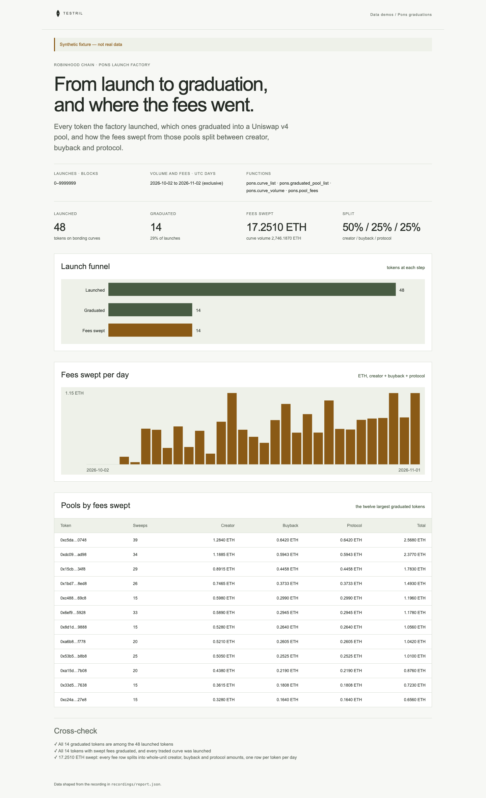

# Pons graduations

A launch funnel for the Pons token launch factory on Robinhood Chain: how many
tokens launched on bonding curves, how many graduated into Uniswap v4 pools,
and how the fees swept from those pools split between creator, buyback and
protocol. The page proves its numbers: every graduated token must be a launched
token, every token with swept fees must have graduated, every traded curve must
have been launched, and every fee row must split into whole raw-unit amounts.

**The shipped recording is synthetic.** `recordings/report.json` is generated
by `test/fixture.mjs` and the page says so in its banner. Record real data with
`tools/prepare` (below).



## Prerequisites

- Node.js 22.13 or later

## Run

Working directory: `demos/pons-graduations`

```sh
npm ci
npm start
```

Open http://127.0.0.1:4180 (set `PORT` to change it). Expected result: the
synthetic banner, four headline numbers, a launched / graduated / fees-swept
funnel, fees swept per day, a table of the twelve pools with the most fees, and
three passed cross-checks.

## Test

```sh
npm test
npx playwright install chromium
npm run test:browser
npm run lint
npm run format:check
```

`npm test` checks the cross-check passes on the fixture and fails when a token
graduated without being launched, when fees are swept from a pool that never
graduated, when a fee split is in ether instead of raw units, and when a sweep
is counted twice, and that the server returns the shaped report.
`npm run test:browser` writes `docs/screenshot-desktop.png`.
`npm run fixture` regenerates the synthetic recording.

## Subjects and window

Chain id `46630` is declared for Robinhood Chain. Every address and block
bound below is a placeholder to confirm before recording.

| Subject                   | Address                                      | Note                    |
| ------------------------- | -------------------------------------------- | ----------------------- |
| Pons launch factory       | `0x7ed598bcef8bd9edd8c97a195c6d13f40801ec7e` | verify before recording |
| Pons fee hook             | `0x5c2e9a4b7d1f3e6a8c0b2d4f6e8a1c3b5d7f09a8` | verify before recording |
| Uniswap v4 position owner | `0x1b0c5a0e2f1d4c3b8a7f6e5d4c3b2a1908f7e6d5` | verify before recording |

- Launches and graduations: blocks `[0, 10000000)`, meant to cover everything
  from the factory's creation; replace the end with the chain head.
- Volume and fees: UTC days `[2026-10-02, 2026-11-02)`.
- Amounts are raw wei of the pair token, which is the native coin (ETH).

## Binds (`testril.json`)

Windows are half-open: the end is the first block or day not included.

| Name           | Function                   | Chain | Params                                        | Window                  |
| -------------- | -------------------------- | ----- | --------------------------------------------- | ----------------------- |
| `launches`     | `pons.curve_list`          | 46630 | `factory`                                     | 0 → 10000000            |
| `graduations`  | `pons.graduated_pool_list` | 46630 | `factory`, `pool_manager`                     | 0 → 10000000            |
| `curve-volume` | `pons.curve_volume`        | 46630 | `swap.curve_list`, `by`                       | 2026-10-02 → 2026-11-02 |
| `pool-fees`    | `pons.pool_fees`           | 46630 | `swap.hook`, `swap.graduated_pool_list`, `by` | 2026-10-02 → 2026-11-02 |

## Record real data

Recording needs `tools/prepare` from this repository and a Testril operator
key with a funded channel; neither is part of an extracted demo. From the
repository root:

```sh
cd tools/prepare && npm ci && cp .env.example .env   # set TESTRIL_MCP_URL and TESTRIL_OPERATOR_KEY
node prepare.mjs --plan ../../demos/pons-graduations   # free estimate
cd ../../demos/pons-graduations && npm run record
```

`npm run record` replaces `recordings/report.json` with `source: "dev"`, the
bound function ids, job ids and timings. The page then shows "Recorded from
Testril on <date>".
