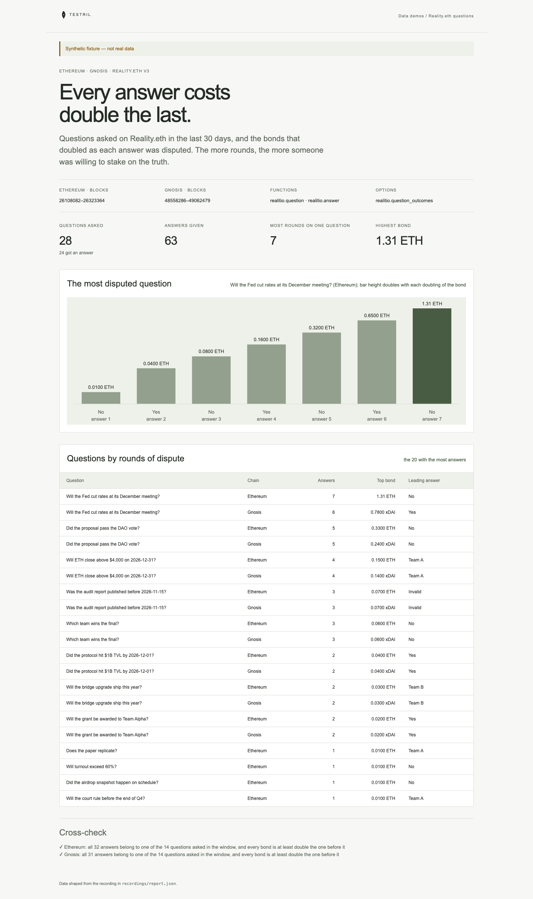

# Reality.eth questions

Questions asked on Reality.eth v3 on Ethereum and Gnosis over the last 30 days,
and the answers given to them. Each new answer must stake at least double the
bond of the one before, so a disputed question climbs a ladder of bonds. The
page shows the most disputed question's ladder and a table of the 20 questions
with the most answers. It proves its numbers: every answer must belong to a
question asked in the window, and every bond must be at least double the
previous bond on the same question.

**The shipped recording is synthetic.** `recordings/synthetic.json` is generated
by `test/fixture.mjs` and the page says so in its banner. Record real data with
`npm run record` (below). A real recording can fail the cross-check, and the page
then shows the failure instead of the passed checks, when:

- an answer in the window belongs to a question asked before it;
- an answer does not beat the previous bond, because `realitio.answer` keeps a
  row for a bond that does not beat the question's bond;
- an answer was revealed from a commitment: its row sits at the reveal block,
  not where it was committed, so block order can misplace it.



## Prerequisites

- Node.js 22.13 or later

## Run

Working directory: `demos/reality-eth-questions`

```sh
npm ci
npm start
```

Open http://127.0.0.1:4180 (set `PORT` to change it). Expected result: the
synthetic banner, four headline numbers, the bond ladder of the most disputed
question, a table of 20 questions and two passed cross-checks.

## Test

```sh
npm test
npx playwright install chromium
npm run test:browser
npm run lint
npm run format:check
```

`npm test` checks the cross-check passes on the fixture (also when answers
arrive out of order, and for a bond of exactly double), fails on an answer to an
unknown question and on a bond raised by only 1.5 times, and that the server
returns the shaped report. `npm run test:browser` writes
`docs/screenshot-desktop.png`. `npm run fixture` regenerates the synthetic
recording.

## Subjects and window

| Subject                 | Chain        | Address                                      | Note                    |
| ----------------------- | ------------ | -------------------------------------------- | ----------------------- |
| Reality.eth v3 (native) | Ethereum (1) | `0x5b7dd1e86623548af054a4985f7fc8ccbb554e2c` | verify before recording |
| Reality.eth v3 (native) | Gnosis (100) | `0xe78996a233895be74a66f451f1019ca9734205cc` | verify before recording |

Both addresses hold contract code on their chain's public RPC; confirm they are
the v3 native-token deployments before recording. Bonds are in raw wei: ETH on
Ethereum and xDAI on Gnosis, both 18 decimals.

The window is 30 UTC days ending 2026-11-01, as a block window (half-open),
found by binary search over public RPCs, not through Testril:

- Ethereum: `[26108082, 26323365)`, the first block of 2026-10-03 to the first
  block of 2026-11-02.
- Gnosis: `[48558286, 49062480)`, the same days.

Gnosis is not yet served by Testril, so its binds are declared but cannot be
recorded until it is.

## Binds (`testril.json`)

| Name                 | Function                     | Chain | Params     | Window              |
| -------------------- | ---------------------------- | ----- | ---------- | ------------------- |
| `ethereum-questions` | `realitio.question`          | 1     | `realitio` | 26108082 → 26323365 |
| `ethereum-answers`   | `realitio.answer`            | 1     | `realitio` | 26108082 → 26323365 |
| `ethereum-outcomes`  | `realitio.question_outcomes` | 1     | `realitio` | 26108082 → 26323365 |
| `gnosis-questions`   | `realitio.question`          | 100   | `realitio` | 48558286 → 49062480 |
| `gnosis-answers`     | `realitio.answer`            | 100   | `realitio` | 48558286 → 49062480 |
| `gnosis-outcomes`    | `realitio.question_outcomes` | 100   | `realitio` | 48558286 → 49062480 |

## Record real data

The demo records itself. It needs a private key whose address holds Testril
usage credits; it pays with vouchers against those credits, so the wallet
needs no USDC.

| Variable            | Purpose                                                    |
| ------------------- | ---------------------------------------------------------- |
| `TESTRIL_PAYER_KEY` | Hex private key that signs vouchers; required to record    |
| `TESTRIL_MCP_URL`   | Testril MCP endpoint; default `https://dev.testril.ai/mcp` |

Working directory: `demos/reality-eth-questions`

```sh
export TESTRIL_PAYER_KEY=<hex private key>
npm run record
```

For each bind in `testril.json`, `npm run record` calls `bind`, asks
`materialize` for the whole window (Testril charges only for blocks not yet
indexed), waits for the job, then `read`s the window. It writes
`recordings/recorded.json` (git-ignored) with `source: "dev"`, the bound
function ids, job ids, timings and the usage credits spent. The page then
shows "Recorded from Testril on <date>". A failed run leaves the previous
recording in place.

`npm test` runs `npm run record` against a fake Testril: it pays with the
payer's vouchers, follows each `materialize` answer and keeps every row.
