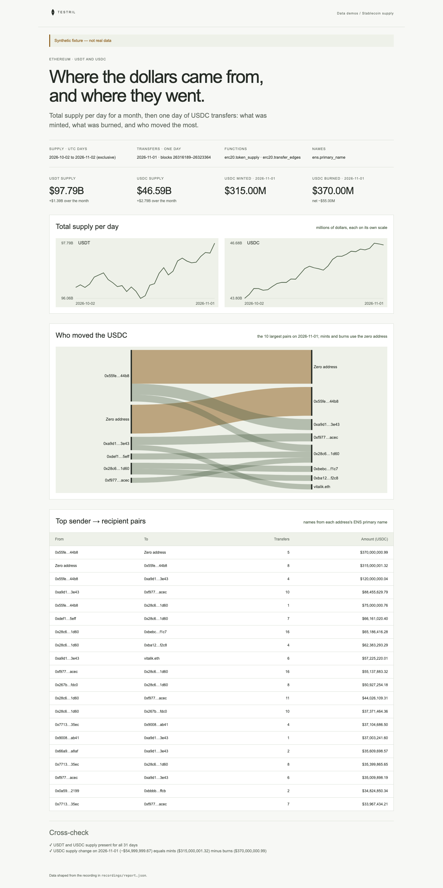

# Stablecoin supply

USDT and USDC total supply per day on Ethereum for a month, then one day of
USDC: what was minted, what was burned, and the largest flows into and out of
twenty well-known addresses, with ENS names on the addresses. The page proves
its numbers: the USDC supply change that day must equal mints minus burns, and
two named addresses that moved USDC to each other must report the same amounts
from both ends.

Every number on the page comes live from Testril when you press **Fetch from
Testril**. The first fetch has Testril index the data; later fetches only read
what Testril already indexed.



## Prerequisites

- Node.js 22.13 or later
- A private key whose address holds Testril usage credits. The demo pays with
  vouchers against those credits, so the wallet needs no USDC.

| Variable            | Purpose                                                    |
| ------------------- | ---------------------------------------------------------- |
| `TESTRIL_PAYER_KEY` | Hex private key that signs vouchers; required to fetch     |
| `TESTRIL_MCP_URL`   | Testril MCP endpoint; default `https://api.testril.si/mcp` |

## Run

Working directory: `demos/stablecoin-supply`

```sh
npm ci
export TESTRIL_PAYER_KEY=<hex private key>
npm start
```

Open http://127.0.0.1:4180 (set `PORT` to change it) and press **Fetch from
Testril**. For each bind the server calls `bind`, asks `materialize` for the
whole window (Testril charges only for blocks it has not indexed yet), follows
the job, then `read`s the window. The page shows a bar per bind and overall from
Testril's own job progress (`blocks_done` of `blocks_total`, `days_done` of
`days_total`) and the usage credits spent. Then it draws four headline numbers,
supply per day for USDT and USDC, a flow of the ten largest USDC flows of the
named addresses, a table of the top 20, and the cross-checks. The windows follow
the moment you press the button, so each new UTC day adds one day to index.
Against production, a fetch of indexed windows is 502 reads and 32,223 rows:
$0.38 and about 5 minutes, most of it the 480 hourly reads of the named
addresses. Nothing is saved: a restart starts empty and the next fetch reads
again.

Without `TESTRIL_PAYER_KEY` the button is disabled and the page says what to set.

## Test

```sh
npm test
npx playwright install chromium
npm run test:browser
npm run lint
npm run format:check
```

`npm test` checks the cross-checks pass on the fixture and fail when a burn is
read as a mint, when supply is in whole dollars instead of raw units, when a day
is missing, or when two named addresses disagree on the USDC between them; that
a flow sums every hour of the day; that a fetch pays a fake Testril with the payer's
vouchers, reports its job progress and keeps every row; and that the server's
fetch ends in the shaped report. `npm run test:browser` presses the button
against the fake Testril and waits for the report. The fixture lives in `test/`
and is never shown on the page.

## Subjects and window

- USDT `0xdac17f958d2ee523a2206206994597c13d831ec7` and USDC
  `0xa0b86991c6218b36c1d19d4a2e9eb0ce3606eb48`, both 6 decimals.
  Every window is computed when you press the button and stated to Testril as
  `from_time` / `to_time`; Testril resolves each end to the first block at or
  after it.

- Supply: the 31 complete UTC days before today, read at each day's last block.
- Mints and burns: yesterday (UTC), so they match the supply rows for the last
  two days. They are the zero address's USDC transfers summed per counterparty:
  a mint is its `sent`, a burn its `received`.
- Flows: each named address's USDC transfers summed per counterparty and hour
  over yesterday, read an hour at a time and summed over the day. A busy address
  has more counterparties in a day than one read serves (Coinbase 10 had 13,537
  hourly rows on 2026-11-17, at most 1,064 in an hour).
- ENS registry `0x00000000000c2e074ec69a0dfb2997ba6c7d2e1e`; each address's
  name is its last row in yesterday's last five minutes.

The 20 named addresses are fixed in `src/report.mjs`, chosen as likely large
USDC movers. Their counterparties show their own ENS name only when they are
named addresses; the rest show shortened hex. On 2026-11-17, seven of them
moved no USDC: Binance 14, Binance 8, Kraken 4, OKX 73, Maker PSM, the 0x
Exchange Proxy and vitalik.eth.

| Subject                         | Address                                      | Note   |
| ------------------------------- | -------------------------------------------- | ------ |
| Circle (USDC issuer)            | `0x55fe002aeff02f77364de339a1292923a15844b8` | verify |
| Binance 14                      | `0x28c6c06298d514db089934071355e5743bf21d60` |        |
| Binance 8                       | `0xf977814e90da44bfa03b6295a0616a897441acec` |        |
| Coinbase 10                     | `0xa9d1e08c7793af67e9d92fe308d5697fb81d3e43` |        |
| Kraken 4                        | `0x267be1c1d684f78cb4f6a176c4911b741e4ffdc0` | verify |
| OKX 73                          | `0x6cc5f688a315f3dc28a7781717a9a798a59fda7b` | verify |
| Bitfinex 2                      | `0x77134cbc06cb00b66f4c7e623d5fdbf6777635ec` | verify |
| Uniswap v3 USDC/WETH 0.05% pool | `0x88e6a0c2ddd26feeb64f039a2c41296fcb3f5640` |        |
| Uniswap v3 USDC/USDT 0.01% pool | `0x3416cf6c708da44db2624d63ea0aaef7113527c6` |        |
| Uniswap v4 PoolManager          | `0x000000000004444c5dc75cb358380d2e3de08a90` |        |
| Uniswap Universal Router        | `0x66a9893cc07d91d95644aedd05d03f95e1dba8af` | verify |
| Curve 3pool                     | `0xbebc44782c7db0a1a60cb6fe97d0b483032ff1c7` |        |
| Aave v3 aEthUSDC                | `0x98c23e9d8f34fefb1b7bd6a91b7ff122f4e16f5c` |        |
| Morpho Blue                     | `0xbbbbbbbbbb9cc5e90e3b3af64bdaf62c37eeffcb` |        |
| Maker PSM USDC                  | `0x0a59649758aa4d66e25f08dd01271e891fe52199` | verify |
| CoW Protocol settlement         | `0x9008d19f58aabd9ed0d60971565aa8510560ab41` |        |
| 1inch v6 router                 | `0x111111125421ca6dc452d289314280a0f8842a65` |        |
| 0x Exchange Proxy               | `0xdef1c0ded9bec7f1a1670819833240f027b25eff` |        |
| Balancer v2 Vault               | `0xba12222222228d8ba445958a75a0704d566bf2c8` |        |
| vitalik.eth                     | `0xd8da6bf26964af9d7eed9e03e53415d37aa96045` |        |

## Binds (`src/report.mjs`)

Windows are half-open: the end is the first block or day not included.

| Name               | Function                      | Chain | Params                                                      | Window                  |
| ------------------ | ----------------------------- | ----- | ----------------------------------------------------------- | ----------------------- |
| `supply`           | `erc20.token_supply`          | 1     | `tokens`, `by: day`                                         | 31 days before today    |
| `usdc-mints-burns` | `erc20.wallet_counterparties` | 1     | `swap: { wallet: zero address, tokens: [USDC] }`, `by: day` | yesterday               |
| `usdc-<subject>`   | `erc20.wallet_counterparties` | 1     | `swap: { wallet: subject, tokens: [USDC] }`, `by: hour`     | yesterday, hour by hour |
| `ens-<subject>`    | `ens.primary_name`            | 1     | `registry`, `address`                                       | yesterday's last 5 min  |

There is one `usdc-` and one `ens-` bind per named address, 42 binds in all.
