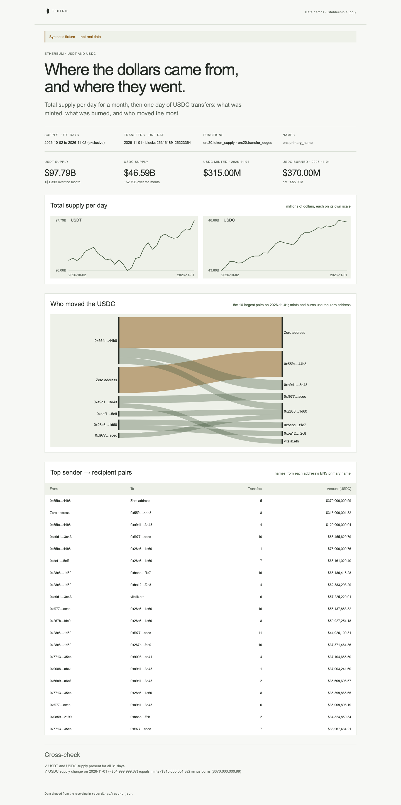

# Stablecoin supply

USDT and USDC total supply per day on Ethereum for a month, then one day of
USDC transfers: what was minted, what was burned, and which sender → recipient
pairs moved the most, with ENS names on the addresses. The page proves its
numbers: the USDC supply change on the transfer day must equal mints minus
burns over the same blocks.

**The shipped recording is synthetic.** `recordings/synthetic.json` is generated
by `test/fixture.mjs` and the page says so in its banner. Record real data with
`npm run record` (below); the server serves `recordings/recorded.json` when it
exists, else the synthetic one.



## Prerequisites

- Node.js 22.13 or later

## Run

Working directory: `demos/stablecoin-supply`

```sh
npm ci
npm start
```

Open http://127.0.0.1:4180 (set `PORT` to change it). Expected result: the
synthetic banner, four headline numbers, supply per day for USDT and USDC, a
flow of the ten largest USDC pairs, a table of the top 20 pairs, and two passed
cross-checks.

## Test

```sh
npm test
npx playwright install chromium
npm run test:browser
npm run lint
npm run format:check
```

`npm test` checks the cross-check passes on the fixture and fails when a burn
is read as a mint, when supply is in whole dollars instead of raw units, or
when a day is missing, and that the server returns the shaped report.
`npm run test:browser` writes `docs/screenshot-desktop.png`.
`npm run fixture` regenerates `recordings/synthetic.json`.

## Subjects and window

- USDT `0xdac17f958d2ee523a2206206994597c13d831ec7` and USDC
  `0xa0b86991c6218b36c1d19d4a2e9eb0ce3606eb48`, both 6 decimals.
- Supply: UTC days `[2026-10-02, 2026-11-02)`, read at each day's last block.
- Transfers: 2026-11-01, blocks `[26316189, 26323365)`: the first block at or
  after 2026-11-01T00:00Z up to the first block of 2026-11-02, so they match the
  supply rows for 2026-10-31 and 2026-11-01.
- ENS registry `0x00000000000c2e074ec69a0dfb2997ba6c7d2e1e`, names read at
  block 26323364, the last block of 2026-11-01.

The 20 named addresses are fixed in `testril.json`, chosen as likely large
USDC movers. Pairs between other addresses show shortened hex.

| Subject                         | Address                                      | Note                    |
| ------------------------------- | -------------------------------------------- | ----------------------- |
| Circle (USDC issuer)            | `0x55fe002aeff02f77364de339a1292923a15844b8` | verify before recording |
| Binance 14                      | `0x28c6c06298d514db089934071355e5743bf21d60` |                         |
| Binance 8                       | `0xf977814e90da44bfa03b6295a0616a897441acec` |                         |
| Coinbase 10                     | `0xa9d1e08c7793af67e9d92fe308d5697fb81d3e43` |                         |
| Kraken 4                        | `0x267be1c1d684f78cb4f6a176c4911b741e4ffdc0` | verify before recording |
| OKX 73                          | `0x6cc5f688a315f3dc28a7781717a9a798a59fda7b` | verify before recording |
| Bitfinex 2                      | `0x77134cbc06cb00b66f4c7e623d5fdbf6777635ec` | verify before recording |
| Uniswap v3 USDC/WETH 0.05% pool | `0x88e6a0c2ddd26feeb64f039a2c41296fcb3f5640` |                         |
| Uniswap v3 USDC/USDT 0.01% pool | `0x3416cf6c708da44db2624d63ea0aaef7113527c6` |                         |
| Uniswap v4 PoolManager          | `0x000000000004444c5dc75cb358380d2e3de08a90` |                         |
| Uniswap Universal Router        | `0x66a9893cc07d91d95644aedd05d03f95e1dba8af` | verify before recording |
| Curve 3pool                     | `0xbebc44782c7db0a1a60cb6fe97d0b483032ff1c7` |                         |
| Aave v3 aEthUSDC                | `0x98c23e9d8f34fefb1b7bd6a91b7ff122f4e16f5c` |                         |
| Morpho Blue                     | `0xbbbbbbbbbb9cc5e90e3b3af64bdaf62c37eeffcb` |                         |
| Maker PSM USDC                  | `0x0a59649758aa4d66e25f08dd01271e891fe52199` | verify before recording |
| CoW Protocol settlement         | `0x9008d19f58aabd9ed0d60971565aa8510560ab41` |                         |
| 1inch v6 router                 | `0x111111125421ca6dc452d289314280a0f8842a65` |                         |
| 0x Exchange Proxy               | `0xdef1c0ded9bec7f1a1670819833240f027b25eff` |                         |
| Balancer v2 Vault               | `0xba12222222228d8ba445958a75a0704d566bf2c8` |                         |
| vitalik.eth                     | `0xd8da6bf26964af9d7eed9e03e53415d37aa96045` |                         |

## Binds (`testril.json`)

Windows are half-open: the end is the first block or day not included.

| Name                           | Function               | Chain | Params                | Window                  |
| ------------------------------ | ---------------------- | ----- | --------------------- | ----------------------- |
| `supply`                       | `erc20.token_supply`   | 1     | `tokens`, `by`        | 2026-10-02 → 2026-11-02 |
| `usdc-edges`                   | `erc20.transfer_edges` | 1     | `token_address`       | 26316189 → 26323365     |
| `ens-circle`                   | `ens.primary_name`     | 1     | `registry`, `address` | 26323364 → 26323365     |
| `ens-binance-14`               | `ens.primary_name`     | 1     | `registry`, `address` | 26323364 → 26323365     |
| `ens-binance-8`                | `ens.primary_name`     | 1     | `registry`, `address` | 26323364 → 26323365     |
| `ens-coinbase-10`              | `ens.primary_name`     | 1     | `registry`, `address` | 26323364 → 26323365     |
| `ens-kraken-4`                 | `ens.primary_name`     | 1     | `registry`, `address` | 26323364 → 26323365     |
| `ens-okx-73`                   | `ens.primary_name`     | 1     | `registry`, `address` | 26323364 → 26323365     |
| `ens-bitfinex-2`               | `ens.primary_name`     | 1     | `registry`, `address` | 26323364 → 26323365     |
| `ens-uniswap-v3-usdc-weth`     | `ens.primary_name`     | 1     | `registry`, `address` | 26323364 → 26323365     |
| `ens-uniswap-v3-usdc-usdt`     | `ens.primary_name`     | 1     | `registry`, `address` | 26323364 → 26323365     |
| `ens-uniswap-v4-pool-manager`  | `ens.primary_name`     | 1     | `registry`, `address` | 26323364 → 26323365     |
| `ens-uniswap-universal-router` | `ens.primary_name`     | 1     | `registry`, `address` | 26323364 → 26323365     |
| `ens-curve-3pool`              | `ens.primary_name`     | 1     | `registry`, `address` | 26323364 → 26323365     |
| `ens-aave-v3-ausdc`            | `ens.primary_name`     | 1     | `registry`, `address` | 26323364 → 26323365     |
| `ens-morpho-blue`              | `ens.primary_name`     | 1     | `registry`, `address` | 26323364 → 26323365     |
| `ens-maker-psm-usdc`           | `ens.primary_name`     | 1     | `registry`, `address` | 26323364 → 26323365     |
| `ens-cow-settlement`           | `ens.primary_name`     | 1     | `registry`, `address` | 26323364 → 26323365     |
| `ens-1inch-v6-router`          | `ens.primary_name`     | 1     | `registry`, `address` | 26323364 → 26323365     |
| `ens-0x-exchange-proxy`        | `ens.primary_name`     | 1     | `registry`, `address` | 26323364 → 26323365     |
| `ens-balancer-v2-vault`        | `ens.primary_name`     | 1     | `registry`, `address` | 26323364 → 26323365     |
| `ens-vitalik`                  | `ens.primary_name`     | 1     | `registry`, `address` | 26323364 → 26323365     |

`usdc-edges` is read in chunks of 600 blocks.

## Record real data

The demo records itself. It needs a private key whose address holds Testril
usage credits; it pays with vouchers against those credits, so the wallet
needs no USDC.

| Variable            | Purpose                                                    |
| ------------------- | ---------------------------------------------------------- |
| `TESTRIL_PAYER_KEY` | Hex private key that signs vouchers; required to record    |
| `TESTRIL_MCP_URL`   | Testril MCP endpoint; default `https://dev.testril.ai/mcp` |

Working directory: `demos/stablecoin-supply`

```sh
export TESTRIL_PAYER_KEY=<hex private key>
npm run record
```

For each bind in `testril.json`, `npm run record` calls `bind`, asks
`materialize` for the whole window (Testril charges only for blocks not yet
indexed), waits for the job, then `read`s the window. It writes
`recordings/recorded.json` (git-ignored) with `source: "dev"`, the bound
function ids, job ids, timings and the usage credits spent. The page then
shows "Recorded from Testril on <date>". A failed run leaves the previous
recording in place.

`npm test` runs `npm run record` against a fake Testril: it pays with the
payer's vouchers, follows each `materialize` answer and keeps every row.
