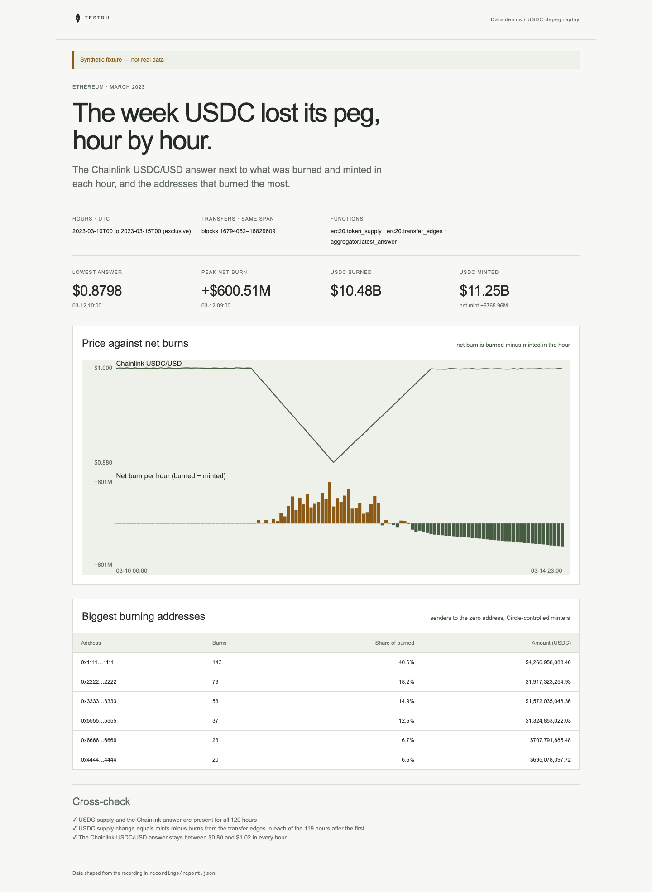

# USDC depeg replay

The Chainlink USDC/USD answer for every hour of 10–14 March 2023 on Ethereum,
next to what USDC burned and minted in the same hours, and the addresses that
burned the most. The page proves its numbers: in every hour the USDC supply
change must equal mints minus burns from the transfer edges, and the Chainlink
answer must stay between $0.80 and $1.02.

**The shipped recording is synthetic.** `recordings/report.json` is generated
by `test/fixture.mjs` and the page says so in its banner. The dip in it is
invented, not the real March 2023 numbers. Record real data with
`tools/prepare` (below).



## Prerequisites

- Node.js 22.13 or later

## Run

Working directory: `demos/usdc-depeg-replay`

```sh
npm ci
npm start
```

Open http://127.0.0.1:4180 (set `PORT` to change it). Expected result: the
synthetic banner, four headline numbers, a timeline of the answer above net
burns per hour, a table of the biggest burning addresses, and three passed
cross-checks.

## Test

```sh
npm test
npx playwright install chromium
npm run test:browser
npm run lint
npm run format:check
```

`npm test` checks the cross-checks pass on the fixture and fail when a burn is
read as a mint, when supply is in whole dollars instead of raw units, when the
answer is read with the wrong decimals, or when an hour is missing, and that the
server returns the shaped report. `npm run test:browser` writes
`docs/screenshot-desktop.png`. `npm run fixture` regenerates the synthetic
recording.

## Subjects and window

- USDC `0xa0b86991c6218b36c1d19d4a2e9eb0ce3606eb48`, 6 decimals.
- Chainlink USDC/USD aggregator `0x8fffffd4afb6115b954bd326cbe7b4ba576818f6`,
  8 decimals. Verify before recording.
- Hours: UTC hours `[2023-03-10T00, 2023-03-15T00)`, read at each hour's last
  block.
- Transfers: blocks `[16794062, 16829610)`, the first block of 2023-03-10T00 up
  to the first block of 2023-03-15T00, so they cover the same 120 hours.
- `src/hour-first-blocks.json` holds the first block of each hour, found by
  binary search over the public RPC ethereum-rpc.publicnode.com. `check` uses
  it to put each transfer edge in its hour.

The first hour has no earlier supply row, so 119 hours are cross-checked.

USDC `burn()` emits a transfer from the caller to the zero address, and the
caller is a Circle-controlled minter, so the burning-addresses table lists
those minters, not the exchanges that sent USDC to Circle. The synthetic
recording mints to Circle `0x55fe002aeff02f77364de339a1292923a15844b8`. Verify
before recording.

## Binds (`testril.json`)

Windows are half-open: the end is the first block or hour not included.

| Name            | Function                   | Chain | Params          | Window                        |
| --------------- | -------------------------- | ----- | --------------- | ----------------------------- |
| `supply`        | `erc20.token_supply`       | 1     | `tokens`, `by`  | 2023-03-10T00 → 2023-03-15T00 |
| `usdc-edges`    | `erc20.transfer_edges`     | 1     | `token_address` | 16794062 → 16829610           |
| `usdc-usd-feed` | `aggregator.latest_answer` | 1     | `feeds`, `by`   | 2023-03-10T00 → 2023-03-15T00 |

`usdc-edges` is read in chunks of 600 blocks.

## Record real data

Recording needs `tools/prepare` from this repository and a Testril operator
key with an existing funded channel; it only signs vouchers and never deposits.
Neither is part of an extracted demo. From the repository root:

```sh
cd tools/prepare && npm ci && cp .env.example .env   # set TESTRIL_MCP_URL and TESTRIL_OPERATOR_KEY
node prepare.mjs --plan ../../demos/usdc-depeg-replay   # free estimate
cd ../../demos/usdc-depeg-replay && npm run record
```

`npm run record` replaces `recordings/report.json` with `source: "dev"`, the
bound function ids, job ids and timings. The page then shows "Recorded from
Testril on <date>".
