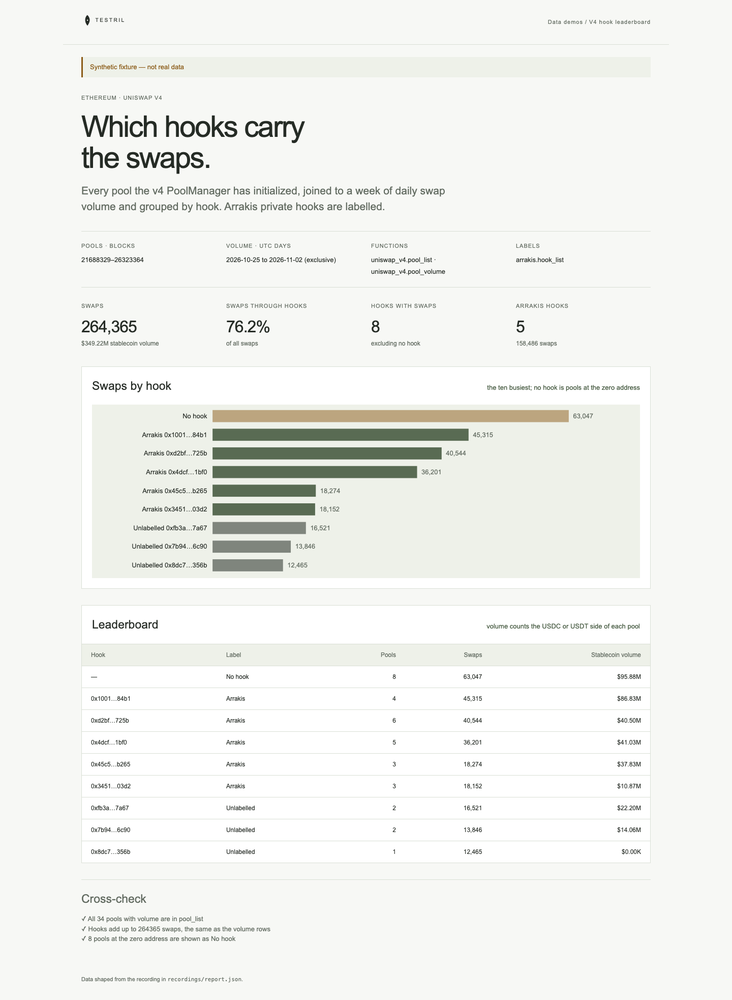

# V4 hook leaderboard

Which Uniswap v4 hooks carry the swaps on Ethereum. Every pool the v4
PoolManager has initialized is joined to a week of daily swap volume and grouped
by its hook; Arrakis private hooks are labelled, and pools at the zero address
are shown as "No hook". The page proves its numbers: every pool with volume
must be in the pool list, and the hooks' swaps must add up to the volume rows'
swaps.

**The shipped recording is synthetic.** `recordings/report.json` is generated
by `test/fixture.mjs` and the page says so in its banner. Record real data with
`tools/prepare` (below).



## Prerequisites

- Node.js 22.13 or later

## Run

Working directory: `demos/v4-hook-leaderboard`

```sh
npm ci
npm start
```

Open http://127.0.0.1:4180 (set `PORT` to change it). Expected result: the
synthetic banner, four headline numbers, a bar chart of swaps for the ten
busiest hooks, a leaderboard table of up to twelve hooks, and three passed
cross-checks.

## Test

```sh
npm test
npx playwright install chromium
npm run test:browser
npm run lint
npm run format:check
```

`npm test` checks the cross-check passes on the fixture and fails when a volume
pool is missing from the pool list, when a pool is listed twice, or when a
volume day is outside the window, that hook totals equal their pools' volume,
that the stablecoin side of each pool is the one summed, and that the server
returns the shaped report. `npm run test:browser` writes
`docs/screenshot-desktop.png`. `npm run fixture` regenerates the synthetic
recording.

## Subjects and window

- Pools: every pool the PoolManager initialized, from its creation block
  21688329 to the first block of 2026-11-02 UTC, `[21688329, 26323365)`
  (the end block is an estimate, verify it before recording).
- Volume: UTC days `[2026-10-25, 2026-11-02)`, one row per pool per day.
- Volume in dollars is the USDC or USDT side of a pool (6 decimals); pools with
  neither show swaps only.
- Arrakis hooks: the private hooks created by the Arrakis hook factory over the
  same blocks.

| Subject                | Address                                      | Note                                                                           |
| ---------------------- | -------------------------------------------- | ------------------------------------------------------------------------------ |
| Uniswap v4 PoolManager | `0x000000000004444c5dc75cb358380d2e3de08a90` |                                                                                |
| Arrakis hook factory   | not set                                      | set `arrakis-hooks.params.factory` before recording                            |
| PoolManager creation   | block 21688329                               | verify before recording                                                        |
| Pool window end        | block 26323365                               | verify before recording: must be the first block at or after 2026-11-02T00:00Z |
| USDC                   | `0xa0b86991c6218b36c1d19d4a2e9eb0ce3606eb48` |                                                                                |
| USDT                   | `0xdac17f958d2ee523a2206206994597c13d831ec7` |                                                                                |

## Binds (`testril.json`)

Windows are half-open: the end is the first block or day not included.

| Name            | Function                 | Chain | Params       | Window                  |
| --------------- | ------------------------ | ----- | ------------ | ----------------------- |
| `pools`         | `uniswap_v4.pool_list`   | 1     | `manager`    | 21688329 → 26323365     |
| `volume`        | `uniswap_v4.pool_volume` | 1     | `swap`, `by` | 2026-10-25 → 2026-11-02 |
| `arrakis-hooks` | `arrakis.hook_list`      | 1     | `factory`    | 21688329 → 26323365     |

`pools` and `arrakis-hooks` are read in chunks of 100000 blocks.

## Record real data

`npm run record` must not be run until the Arrakis hook factory address in
`testril.json` replaces its `VERIFY_…` placeholder and the end block is read
from the chain.

Recording needs `tools/prepare` from this repository and a Testril operator
key with a funded channel; neither is part of an extracted demo. From the
repository root:

```sh
cd tools/prepare && npm ci && cp .env.example .env   # set TESTRIL_MCP_URL and TESTRIL_OPERATOR_KEY
node prepare.mjs --plan ../../demos/v4-hook-leaderboard   # free estimate
cd ../../demos/v4-hook-leaderboard && npm run record
```

`npm run record` replaces `recordings/report.json` with `source: "dev"`, the
bound function ids, job ids and timings. The page then shows "Recorded from
Testril on <date>".
