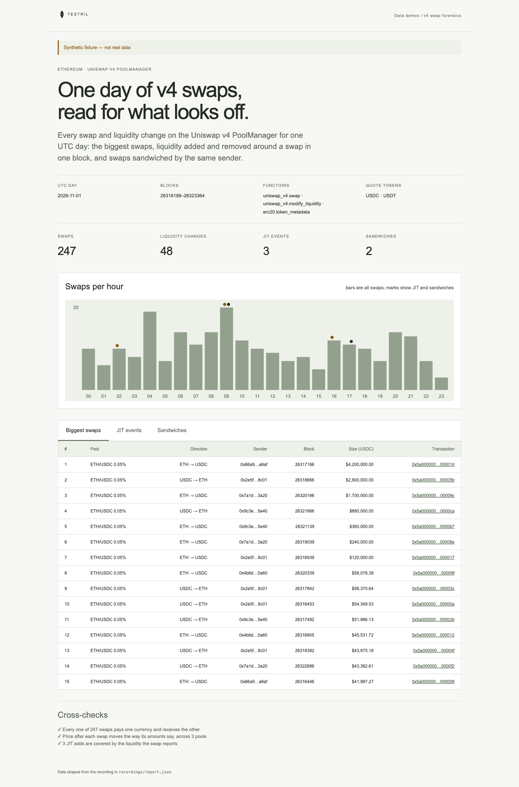

# v4 swap forensics

One UTC day of Uniswap v4 activity on Ethereum, read for what looks off: the
biggest swaps, JIT liquidity (liquidity added and removed again around a swap in
one block) and sandwiches (the same sender swapping before and after someone
else's swap in the same pool and block, in opposite directions). Each finding
links its transactions on Etherscan. The page proves its numbers with three
cross-checks (below).

**The shipped recording is synthetic.** `recordings/synthetic.json` is generated
by `test/fixture.mjs` and the page says so in its banner. Its transaction hashes
are made up and do not resolve to real transactions. Record real data with
`npm run record` (below).



## Prerequisites

- Node.js 22.13 or later

## Run

Working directory: `demos/v4-swap-forensics`

```sh
npm ci
npm start
```

Open http://127.0.0.1:4180 (set `PORT` to change it). Expected result: the
synthetic banner, four headline counts, swaps per hour with JIT and sandwich
marks, three tabs (biggest swaps, JIT events, sandwiches) and three passed
cross-checks.

## Test

```sh
npm test
npx playwright install chromium
npm run test:browser
npm run lint
npm run format:check
```

`npm test` checks the cross-checks pass on the fixture and fail when a swap's
amounts disagree with its price move, when a swap pays and receives the same
sign, when a swap reports less liquidity than the JIT add before it, when a row
is outside the window or when USDC decimals are wrong. It also checks that a
remove one unit short of the add is not JIT, that two same-direction swaps are
not a sandwich, and that the server returns the shaped report.
`npm run test:browser` writes `docs/screenshot-desktop.png`.
`npm run fixture` regenerates the synthetic recording.

## Cross-checks

- Every swap pays one currency and receives the other (amounts have opposite
  signs).
- Price after each swap moves the way its amounts say: selling currency0 never
  raises the pool's price, buying it never lowers it, compared with the pool's
  previous swap.
- A JIT add in range is covered by the liquidity the following swap reports.

All comparisons use raw integer units (BigInt).

## Definitions

- JIT: an add and an exactly negated remove of the same position (sender, pool,
  ticks, salt) in one block, with a swap in that pool between them.
- Sandwich: two consecutive swaps by one sender in one pool and block, in
  opposite directions, with a swap by a different sender between them. The
  sender is whoever called the PoolManager, often a router shared by many
  users, so on real data this finds candidates, not proof of an attack.
- Biggest swaps: ranked by USDC amount, for pools listed in `knownPools` in
  `src/report.mjs`. Other pools still count in JIT and sandwich findings.

## Subjects and window

| Subject                | Address / id                                                         | Note                    |
| ---------------------- | -------------------------------------------------------------------- | ----------------------- |
| Uniswap v4 PoolManager | `0x000000000004444c5dc75cb358380d2e3de08a90`                         |                         |
| USDC                   | `0xa0b86991c6218b36c1d19d4a2e9eb0ce3606eb48`                         |                         |
| USDT                   | `0xdac17f958d2ee523a2206206994597c13d831ec7`                         |                         |
| ETH/USDC 0.05% pool id | `0xdce6394339af00981949f5f3baf27e3610c76326a700af57e4b3e3ae4977f78d` | verify before recording |

- Day: 2026-11-01 UTC, blocks `[26316189, 26323365)` (half-open: the end is the
  first block of 2026-11-02), found by binary search over a public RPC.
- Swaps and liquidity changes are read in 300-block chunks (about one hour).

## Binds (`testril.json`)

| Name        | Function                      | Chain | Params         | Window                  |
| ----------- | ----------------------------- | ----- | -------------- | ----------------------- |
| `swaps`     | `uniswap_v4.swap`             | 1     | `manager`      | 26316189 → 26323365     |
| `liquidity` | `uniswap_v4.modify_liquidity` | 1     | `manager`      | 26316189 → 26323365     |
| `tokens`    | `erc20.token_metadata`        | 1     | `tokens`, `by` | 2026-11-01 → 2026-11-02 |

## Record real data

The demo records itself. It needs a private key whose address holds Testril
usage credits; it pays with vouchers against those credits, so the wallet
needs no USDC.

| Variable            | Purpose                                                    |
| ------------------- | ---------------------------------------------------------- |
| `TESTRIL_PAYER_KEY` | Hex private key that signs vouchers; required to record    |
| `TESTRIL_MCP_URL`   | Testril MCP endpoint; default `https://dev.testril.ai/mcp` |

Working directory: `demos/v4-swap-forensics`

```sh
export TESTRIL_PAYER_KEY=<hex private key>
npm run record
```

For each bind in `testril.json`, `npm run record` calls `bind`, asks
`materialize` for the whole window (Testril charges only for blocks not yet
indexed), waits for the job, then `read`s the window. It writes
`recordings/recorded.json` (git-ignored) with `source: "dev"`, the bound
function ids, job ids, timings and the usage credits spent. The page then
shows "Recorded from Testril on <date>". A failed run leaves the previous
recording in place.

`npm test` runs `npm run record` against a fake Testril: it pays with the
payer's vouchers, follows each `materialize` answer and keeps every row.
