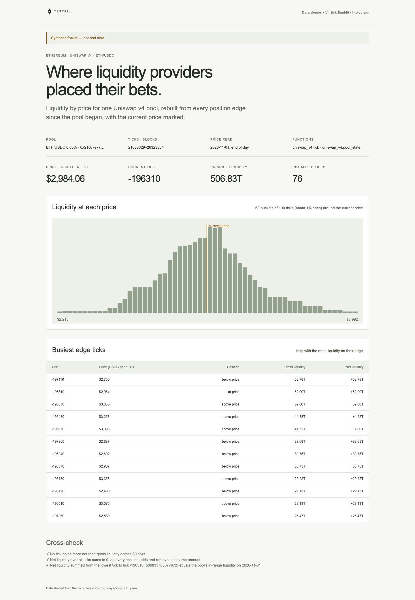

# V4 tick liquidity histogram

Liquidity by price for one ETH/USDC Uniswap v4 pool on Ethereum, rebuilt from
every position edge tick since the pool began, with the current price marked.
The page proves its numbers: net liquidity summed across ticks from the lowest
up to the current tick must equal the pool's in-range liquidity.

**The shipped recording is synthetic.** `recordings/report.json` is generated
by `test/fixture.mjs` and the page says so in its banner. Record real data with
`tools/prepare` (below).



## Prerequisites

- Node.js 22.13 or later

## Run

Working directory: `demos/v4-tick-heatmap`

```sh
npm ci
npm start
```

Open http://127.0.0.1:4180 (set `PORT` to change it). Expected result: the
synthetic banner, price, tick and in-range liquidity, a histogram of liquidity
across 60 price buckets with a marker at the current price, a table of the 12
busiest edge ticks, and three passed cross-checks.

## Test

```sh
npm test
npx playwright install chromium
npm run test:browser
npm run lint
npm run format:check
```

`npm test` checks the cross-check passes on the fixture and fails when an upper
edge is read as added liquidity, when a tick's latest row is missing, when the
pool's tick is off by one spacing, or when a row belongs to another pool, and
that the server returns the shaped report. `npm run test:browser` writes
`docs/screenshot-desktop.png`. `npm run fixture` regenerates the recording.

## Subjects and window

| Subject                   | Value                                                                | Note                       |
| ------------------------- | -------------------------------------------------------------------- | -------------------------- |
| Uniswap v4 PoolManager    | `0x000000000004444c5dc75cb358380d2e3de08a90`                         |                            |
| ETH/USDC 0.05% pool id    | `0x21c67e77068de97969ba93d4aab21826d33ca12bb9f565d8496e8fda8a82ca27` | hash of the pool key below |
| Tick window start (block) | 21688329                                                             | verify before recording    |
| Tick window end (block)   | 26323365                                                             | first block of 2026-11-02  |

- Pool key (hashed to the pool id as `keccak256(abi.encode(currency0, currency1, fee, tickSpacing, hooks))`):
  currency0 native ETH (`0x0000000000000000000000000000000000000000`),
  currency1 USDC (`0xA0b86991c6218b36c1d19D4a2e9Eb0cE3606eB48`), fee 500
  (0.05%), tickSpacing 10, hooks `0x0000000000000000000000000000000000000000`.
- Ticks: blocks `[21688329, 26323365)`, from the PoolManager's deployment (at
  or before the pool's initialization) to the end of 2026-11-01; 26323365 is the first block with a timestamp on
  2026-11-02 UTC (block 26323364 is 2026-11-01 23:59:59). Blocks before
  the pool's initialization have no rows.
- Pool state: UTC day 2026-11-01, read at the day's last block (26323364).
  `to_day` is exclusive, so the window ends 2026-11-02.
- Price is USDC per ETH: `1.0001^tick × 10^12`, as ETH has 18 decimals and
  USDC 6.

## Binds (`testril.json`)

Windows are half-open: the end is the first block or day not included.

| Name         | Function                | Chain | Params                  | Window                  |
| ------------ | ----------------------- | ----- | ----------------------- | ----------------------- |
| `ticks`      | `uniswap_v4.tick`       | 1     | `manager`, `pool`       | 21688329 → 26323365     |
| `pool-state` | `uniswap_v4.pool_state` | 1     | `manager`, `pool`, `by` | 2026-11-01 → 2026-11-02 |

`ticks` is read in chunks of 200000 blocks.

## Record real data

Recording needs `tools/prepare` from this repository and a Testril operator
key with a funded channel; neither is part of an extracted demo. From the
repository root:

```sh
cd tools/prepare && npm ci && cp .env.example .env   # set TESTRIL_MCP_URL and TESTRIL_OPERATOR_KEY
node prepare.mjs --plan ../../demos/v4-tick-heatmap   # free estimate
cd ../../demos/v4-tick-heatmap && npm run record
```

`npm run record` replaces `recordings/report.json` with `source: "dev"`, the
bound function ids, job ids and timings. The page then shows "Recorded from
Testril on <date>".
