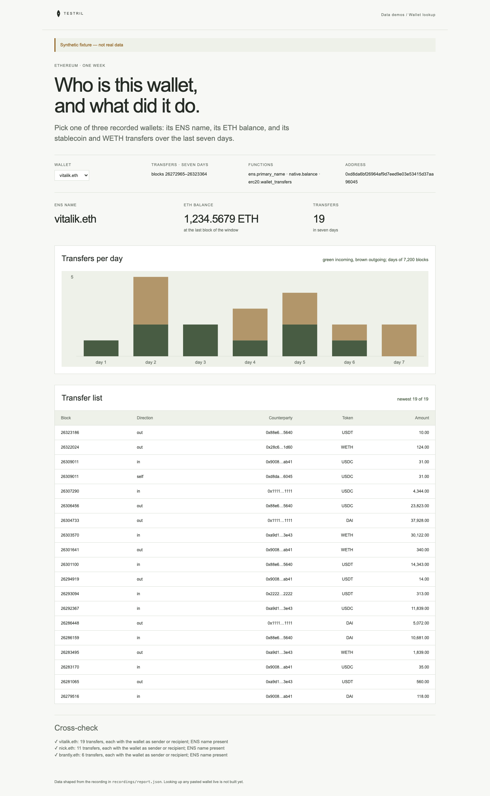

# Wallet lookup

Pick a wallet and see its ENS name, ETH balance and the last seven days of
ERC-20 transfers (USDC, USDT, DAI, WETH) on Ethereum. The page proves its
numbers: every listed transfer must name the wallet as sender or recipient, and
every wallet must have a recorded ENS name and a balance.

**The shipped recording is synthetic.** `recordings/synthetic.json` is generated
by `test/fixture.mjs` and the page says so in its banner. Record real data with
`npm run record` (below). The page offers three recorded wallets; looking up any
pasted wallet live, per visitor, is deferred.



## Prerequisites

- Node.js 22.13 or later

## Run

Working directory: `demos/wallet-lookup`

```sh
npm ci
npm start
```

Open http://127.0.0.1:4180 (set `PORT` to change it). Expected result: the
synthetic banner, a wallet picker, ENS name, ETH balance and transfer count, a
chart of incoming and outgoing transfers per day, the newest 25 transfers, and
three passed cross-checks.

## Test

```sh
npm test
npx playwright install chromium
npm run test:browser
npm run lint
npm run format:check
```

`npm test` checks the cross-check passes on the fixture and fails when a
transfer does not involve the wallet, an ENS name is empty, or a transfer lies
outside the window, and that raw units display at their decimals.
`npm run test:browser` writes `docs/screenshot-desktop.png`.
`npm run fixture` regenerates the synthetic recording.

## Subjects and window

- Transfers: seven days of 7,200 blocks, `[26272965, 26323365)`, ending at the
  first block of 2026-11-02 (estimate, verify before recording).
- Balance and ENS name: read at block 26323364, the last block of 2026-11-01 (estimate, verify before recording).
- ENS registry `0x00000000000c2e074ec69a0dfb2997ba6c7d2e1e`.
- Tokens: USDC `0xa0b86991c6218b36c1d19d4a2e9eb0ce3606eb48`, USDT
  `0xdac17f958d2ee523a2206206994597c13d831ec7`, DAI
  `0x6b175474e89094c44da98b954eedeac495271d0f`, WETH
  `0xc02aaa39b223fe8d0a0e5c4f27ead9083c756cc2`.

| Wallet      | Address                                      | Note                    |
| ----------- | -------------------------------------------- | ----------------------- |
| vitalik.eth | `0xd8da6bf26964af9d7eed9e03e53415d37aa96045` |                         |
| nick.eth    | `0xb8c2c29ee19d8307cb7255e1cd9cbde883a267d5` | verify before recording |
| brantly.eth | `0x983110309620d911731ac0932219af06091b6744` | verify before recording |

## Binds (`testril.json`)

Windows are half-open: the end is the first block not included.

| Name                | Function                 | Chain | Params              | Window              |
| ------------------- | ------------------------ | ----- | ------------------- | ------------------- |
| `ens-vitalik`       | `ens.primary_name`       | 1     | `registry, address` | 26323364 → 26323365 |
| `ens-nick`          | `ens.primary_name`       | 1     | `registry, address` | 26323364 → 26323365 |
| `ens-brantly`       | `ens.primary_name`       | 1     | `registry, address` | 26323364 → 26323365 |
| `balance`           | `native.balance`         | 1     | `owners`            | 26323364 → 26323365 |
| `transfers-vitalik` | `erc20.wallet_transfers` | 1     | `wallet, tokens`    | 26272965 → 26323365 |
| `transfers-nick`    | `erc20.wallet_transfers` | 1     | `wallet, tokens`    | 26272965 → 26323365 |
| `transfers-brantly` | `erc20.wallet_transfers` | 1     | `wallet, tokens`    | 26272965 → 26323365 |

`transfers-*` are read in chunks of 7,200 blocks.

## Record real data

The demo records itself. It needs a private key whose address holds Testril
usage credits; it pays with vouchers against those credits, so the wallet
needs no USDC.

| Variable            | Purpose                                                    |
| ------------------- | ---------------------------------------------------------- |
| `TESTRIL_PAYER_KEY` | Hex private key that signs vouchers; required to record    |
| `TESTRIL_MCP_URL`   | Testril MCP endpoint; default `https://dev.testril.ai/mcp` |

Working directory: `demos/wallet-lookup`

```sh
export TESTRIL_PAYER_KEY=<hex private key>
npm run record
```

For each bind in `testril.json`, `npm run record` calls `bind`, asks
`materialize` for the whole window (Testril charges only for blocks not yet
indexed), waits for the job, then `read`s the window. It writes
`recordings/recorded.json` (git-ignored) with `source: "dev"`, the bound
function ids, job ids, timings and the usage credits spent. The page then
shows "Recorded from Testril on <date>". A failed run leaves the previous
recording in place.

`npm test` runs `npm run record` against a fake Testril: it pays with the
payer's vouchers, follows each `materialize` answer and keeps every row.
